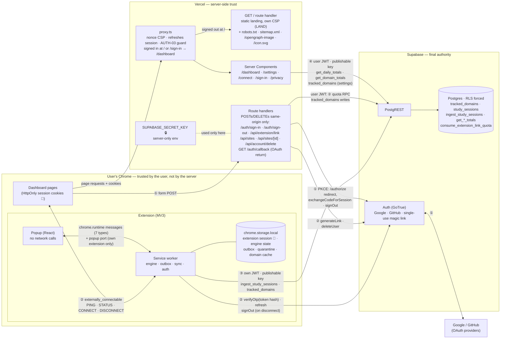

# CareerOS

[](https://github.com/vbenedito/careeros/actions/workflows/ci.yml)

Track and understand your technical-interview study time — automatically and privately.

> **Status:** v0 is delivered and approved (Gate 4). The landing page is live at `/`; the dashboard is at `/dashboard`. The Chrome Web Store submission is in progress ([STORE spec](specs/store/00-chrome-web-store.md)).

## What v0 does

- A **Chrome extension** measures time on the study sites you choose. It counts only while the site is the active tab of the focused Chrome window and you are active; a tab playing sound (not muted) keeps counting for up to 15 minutes without input. It works offline and uploads later.
- A **web dashboard** shows today, the week or month, the top platform, study time per day and time by platform, and lets you manage your sites, the extension connection and your account.
- Sign in with **Google or GitHub**. From your browsing, only the domain of a tracked site, the start and end of each study period and a random device id are stored: never full addresses, page content or other sites. Your data is visible only to you; deleting your account removes it from the live database immediately, and from the encrypted backups within 90 days ([privacy](specs/v0/07-security-privacy.md)).

## Architecture

pnpm monorepo · Chrome MV3 extension (TypeScript, React, Tailwind) · Next.js dashboard (shadcn/ui on Radix, Recharts) · Supabase (Postgres + RLS + Auth) · Docker-based local backend · GitHub Actions CI.



① sign-in · ② extension connection · ③ tracking → upload · ④ dashboard totals. 🔑 a user's own session (the dashboard and the extension never share one) · 🔒 the Supabase secret key, server-only. Legend, flows and detailed designs: [`docs/architecture/`](docs/architecture/overview.md); decisions: [ADRs](docs/adr/).

## How this project is built

Specification-Driven Development with explicit approval gates:

1. Understanding & direction — *approved*
2. v0 specs & backlog — *approved* → [`specs/`](specs/), [`docs/history/backlog/v0.md`](docs/history/backlog/v0.md)
3. v0 implementation — *done*: one issue per branch, tests named after requirement IDs, an independent review before every merge
4. v0 delivery — *approved*
5. Further iterations only on request — so far the landing page ([LAND](specs/landing/00-landing.md), live) and the Chrome Web Store publication ([STORE](specs/store/00-chrome-web-store.md), submission in progress); [`docs/roadmap.md`](docs/roadmap.md) lists other candidates, none authorized

## Documentation

Start at [`docs/README.md`](docs/README.md): the index of every doc, its owner and status. Specs say **what**, architecture says **how**, ADRs say **why**, history is frozen.

| Need | Go to |
|---|---|
| Requirements | [`specs/`](specs/README.md) (v0, [landing](specs/landing/00-landing.md), [Chrome Web Store](specs/store/00-chrome-web-store.md)) |
| How it is built | [Overview](docs/architecture/overview.md) · [extension](docs/architecture/extension.md) · [web](docs/architecture/web.md) · [database](docs/architecture/database.md) · [glossary](docs/glossary.md) |
| Why | [ADRs](docs/adr/README.md) |
| How we work and release | [Contributing](docs/process/contributing.md) · [release](docs/process/release.md) · [`AGENTS.md`](AGENTS.md) |
| Running it | [Operations](docs/operations.md) · [design system](docs/design-system.md) · [store listing](docs/chrome-web-store/listing.md) |
| Past records | [History](docs/history/README.md): v0 backlog, spike, [security review](docs/history/security-review-v0.md) and [audit](docs/history/security-audit-v0.md), [delivery report](docs/history/delivery/v0-delivery-report.md) |

## Setup

Requirements: **Node.js 26 LTS** (see `.nvmrc`; `nvm use`) and **pnpm 12** (`corepack enable` picks the version pinned in `package.json`). Docker Desktop is needed for backend work.

```bash
pnpm install
pnpm check        # lint + typecheck + unit tests
pnpm build        # builds every workspace that has a build step
pnpm --filter @careeros/web dev   # dashboard on http://localhost:3000
```

### Local backend (Supabase in Docker)

Requires **Docker Desktop running**. The Supabase CLI is a dev dependency, so no global install is needed.

```bash
pnpm db:start     # start Postgres, Auth, PostgREST, Studio, Mailpit in Docker
pnpm db:status    # print the local API URL, keys and Studio URL
pnpm db:reset     # re-apply supabase/migrations + supabase/seed.sql
pnpm db:test      # run pgTAP tests in supabase/tests/database
pnpm db:stop      # stop the containers (data volumes are kept)
```

Then run **`pnpm setup:env`**: it writes the local Supabase URL and keys into `apps/web/.env.local` and `apps/extension/.env.development` (both git-ignored). Restart the dashboard dev server and rebuild the extension afterwards. Local services: API `http://127.0.0.1:54321`, Studio `http://127.0.0.1:54323`, Mailpit (captured e-mails) `http://127.0.0.1:54324`.

The first `db:start` pulls several Docker images (a few GB) and can take a few minutes. Realtime, Storage, Edge Functions and Analytics are disabled in `supabase/config.toml` because v0 doesn't use them.

### Chrome extension (unpacked)

```bash
pnpm --filter @careeros/extension build        # dev build  → apps/extension/dist/development
pnpm --filter @careeros/extension release      # prod zip (needs apps/extension/.env.production)
```

Load it in Chrome: `chrome://extensions` → enable **Developer mode** → **Load unpacked** → select `apps/extension/dist/development`. After rebuilding, click the reload icon on the extension card.

The extension ID is pinned by a public key in the manifest, so it is the same on every machine:

| Build | Name | Extension ID |
|---|---|---|
| development | CareerOS (dev) | `jfklbpedlpkginmdfckogdgaggmdmkbk` |
| production | CareerOS | `pddbflgidjmnhidineoejneeipaicgek` |

Both can be installed side by side. Permissions are exactly `alarms`, `idle`, `storage`, `tabs` (SEC-03, enforced by a test).

### Tests

| Layer | Command | Needs |
|---|---|---|
| Unit and component | `pnpm test` (`pnpm test:coverage` enforces ≥ 90 % on shared rules and the tracking engine) | nothing |
| Database (pgTAP: RLS, constraints, RPCs) | `pnpm db:test` | local backend |
| Integration and E2E (real Chromium: dashboard journey, extension smoke) | `scripts/ci/integration.sh` | local backend, `pnpm --filter @careeros/extension exec playwright install chromium` |
| Backup → restore round trip | `scripts/ops/backup-restore-test.sh` (resets the local database) | local backend, [age](https://age-encryption.org) |

CI runs all of them on every pull request.

### Repository layout

```
apps/extension   Chrome MV3 extension
apps/web         Next.js dashboard
packages/shared  rules, schemas and constants used by both apps
supabase         migrations, pgTAP tests, local config
scripts          CI and operations scripts (integration run, backup/restore)
specs/ docs/     specifications; docs index, architecture, ADRs, process, operations, history
```

### Toolchain versions

| Tool | Version | Note |
|---|---|---|
| Node.js | 26 LTS | Active LTS since Oct 2026; Vercel default runtime for new projects |
| pnpm | 12.16.1 | New package versions must be 7 days old (`minimumReleaseAge`, #112); dependencies are pinned exactly; Dependabot proposes updates weekly |
| TypeScript | 7.0.2 | |
| Next.js / React | 16.4.4 / 19.3.1 | |
| Vitest | 5.1.0 | |
| Biome | 2.6.4 | single lint + format tool (React, Next.js and test rule domains) |
| Supabase CLI | 3.0.0 | dev dependency; local stack runs in Docker (ADR-0008) |
| Vite | 8.3.5 | extension build (MV3 service worker + popup) |
