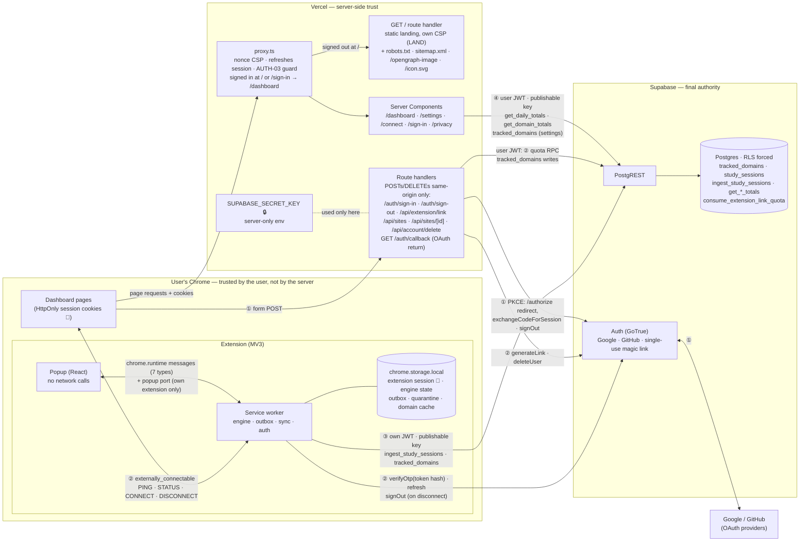
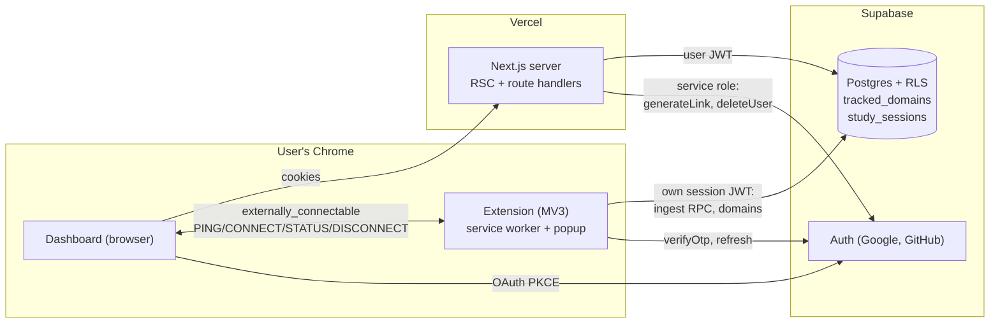
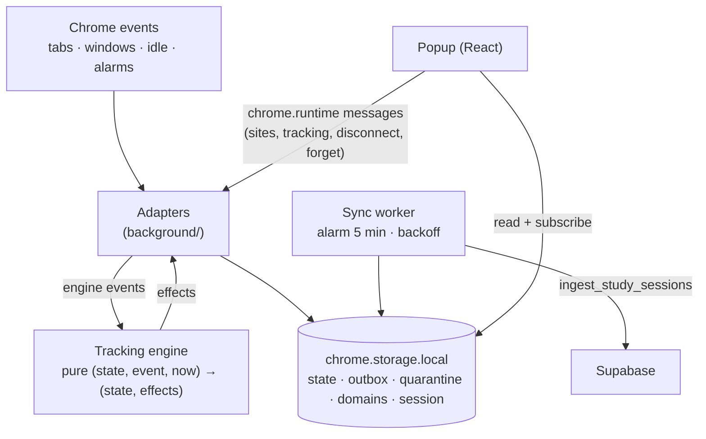
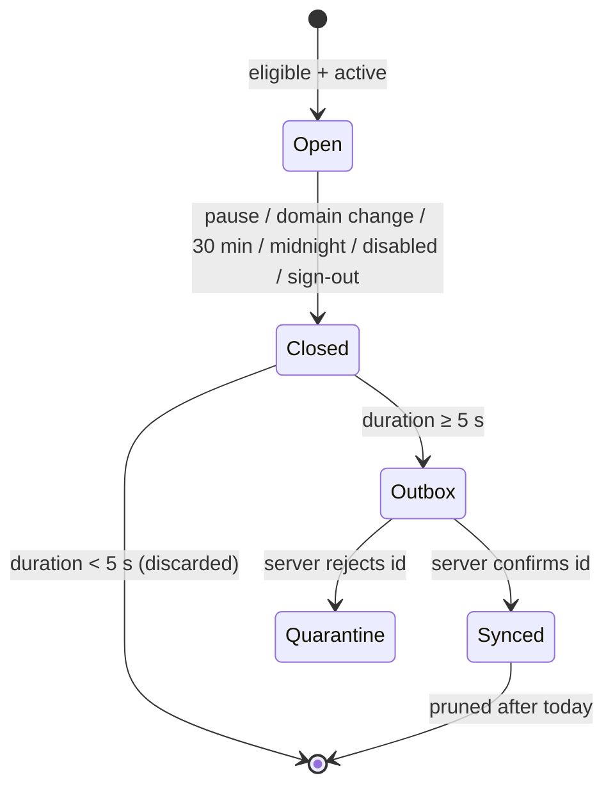

# Architecture (v0)

Status: **Approved** (Gate 2, 2026-11-04). Details live in [`specs/v0`](../specs/v0/) and [`docs/adr`](adr/).

Updated 2026-11-11 (#131): landing page at `/`, dashboard at `/dashboard`, public routes, popup ↔ worker messages. A full rewrite is planned.

## System design (as implemented)

One picture of v0 as merged: components, trust boundaries, where each credential lives, and the four main flows (numbers match the table below). Checked against the code, specs and migrations on 2026-11-08.

**Legend**

| Mark | Meaning |
|---|---|
| Boxes `CHROME` / `VERCEL` / `SUPA` | Trust boundaries. Nothing inside Chrome is trusted by the server: every request carries a user JWT and RLS decides. |
| 🔑 | A user's own session (refresh token). Dashboard: HttpOnly, SameSite=Lax cookies. Extension: its **own** session in `chrome.storage.local`; the two never share refresh tokens (ADR-0003). |
| 🔒 | The Supabase **secret key**: Vercel server env only, never `NEXT_PUBLIC_`, never in the extension (SEC-07). Used for `generateLink` (connect) and `deleteUser` (account deletion). |
| Publishable key | Public by design (`sb_publishable_…`): in the extension bundle and the dashboard server; RLS protects the data. |

**Flows**

| # | Flow | Path | Specs |
|---|---|---|---|
| ① | Sign-in | Sign-in form → `/auth/sign-in` → Supabase `/authorize` (PKCE) → Google/GitHub → `/auth/callback` exchanges the code → session cookies. `/auth/sign-out` ends this session or, with "all devices", every session | AUTH-01..05, AUTH-12a |
| ② | Extension connection | `/connect` sends `PING` → `POST /api/extension/link` (same origin, `getUser()`, 5/min quota) mints a single-use token hash with the secret key → page sends `CONNECT` to the extension → extension `verifyOtp` → its own session. `DISCONNECT` signs it out | AUTH-06..12 |
| ③ | Tracking → sync | Chrome events → pure engine → closed intervals into the outbox (one storage write with the state) → every 5 min, on worker start and after (re)connecting: `ingest_study_sessions` with the extension's JWT → confirmed ids leave the outbox, rejected ones go to quarantine | TRK-*, SYNC-01..08, ADR-0004 |
| ④ | Dashboard totals | `tz` cookie (viewer's IANA zone) → Server Components call `get_daily_totals` / `get_domain_totals` with the user's JWT → cards, bar chart, donut | DASH-04..10, DATA-10/11 |

**Public routes** (AUTH-03): `/` (landing, served by `app/route.ts` to signed-out visitors), `/robots.txt`, `/sitemap.xml`, `/opengraph-image`, `/icon.svg`, `/fonts/*`, `/sign-in`, `/auth/sign-in`, `/auth/callback`, `/privacy`. Everything else needs a session; a signed-in visitor at `/` or `/sign-in` is redirected to `/dashboard`.

**Popup ↔ service worker:** the popup reads state from `chrome.storage.local` and has no Supabase client. Commands go to the worker only as `chrome.runtime.sendMessage` messages, validated with Zod (`lib/popup-messages.ts`): `AUTH_STATUS`, `DOMAINS_REFRESH`, `DOMAINS_ADD`, `DOMAINS_REMOVE`, `TRACKING_SET`, `DISCONNECT`, `FORGET_LOCAL_DATA`. While it is shown, the popup also holds a `chrome.runtime.connect` port (`careeros.popup`), so the worker counts Chrome as focused (TRK-18).

Tracked sites are read and written by both apps through `tracked_domains` (RLS, 50-site trigger); the extension refreshes its cache on startup, each sync cycle, after connecting and when the popup opens (SYNC-09..11).

## System context (Gate 2 overview)

## Extension internals

Key properties:

- **Engine is pure** (TRK-16): all rules testable with a fake clock; Chrome specifics isolated in adapters.
- **Everything persisted** (TRK-12): the service worker can die at any time.
- **Exactly-once sync** (ADR-0004): client UUIDs + `ON CONFLICT DO NOTHING` + server-confirmed removal from the outbox.
- **Independent sessions** (ADR-0003): dashboard and extension never share refresh tokens.

## Interval lifecycle

## Code organization & conventions

The rule of thumb: **use a pattern when it solves a problem we have now, and make it explicit when we do.** Every abstraction must earn its place; new dependencies and patterns come with a one-line reason in their PR.

### Where code goes

| Path | Contains | Must not contain |
|---|---|---|
| `packages/shared` | Rules and schemas used by **both** apps (domain matching, Zod schemas, constants, formatting) | Browser, Chrome or Node APIs; app-specific code |
| `apps/extension/src/engine` | Pure tracking rules (TRK-16) | Chrome APIs, storage, timers |
| `apps/extension/src/background` | Service worker: Chrome adapters, storage, sync, auth | UI code |
| `apps/extension/src/popup` | Popup UI | Network or Supabase calls (EXT-UI-05a) |
| `apps/web` | Next.js dashboard (routes, components, server code) | Extension logic |
| `supabase/migrations` | Schema, policies, functions — append-only | Edits to applied migrations |
| `supabase/tests/database` | pgTAP tests (`001_helpers` provides shared helpers) | |

Folders are organized **by feature**, not by technical layer (no generic `controllers/`, `services/`, `repositories/`).

### Patterns in use

| Pattern | Where | Why |
|---|---|---|
| **Functional core, imperative shell** (a light form of ports & adapters) | Extension: pure `engine/`, thin `background/` adapters | The trickiest rules (idle, media, midnight, crash recovery) are testable with a fake clock |
| **Transactional outbox + idempotent consumer** | Extension outbox → `ingest_study_sessions` | No lost or duplicated time across retries, offline periods and worker restarts (ADR-0004) |
| **Deny by default** | Database grants, RLS, default privileges | New tables and functions are never exposed by accident; every access is granted explicitly (DATA-04/05) |
| **Database as the final authority** | Domain types, constraints, triggers, single write RPC | Rules hold even if a client is buggy or malicious |
| **Validate at the boundary** | Shared Zod schemas at messages, uploads and user input | Inner code works with trusted, typed data (SEC-10) |
| **Specs as the source of truth** | Requirement IDs in tests; drift tests for constants and the domain regex | Code, spec and database cannot silently disagree |

### Deliberately not used (for now)

Dependency-injection containers · repository/service layers over Supabase · state-management libraries · base classes · build orchestrators (Turborepo/Nx) · a separate backend API. Each is reconsidered when a concrete need appears, through an ADR.
