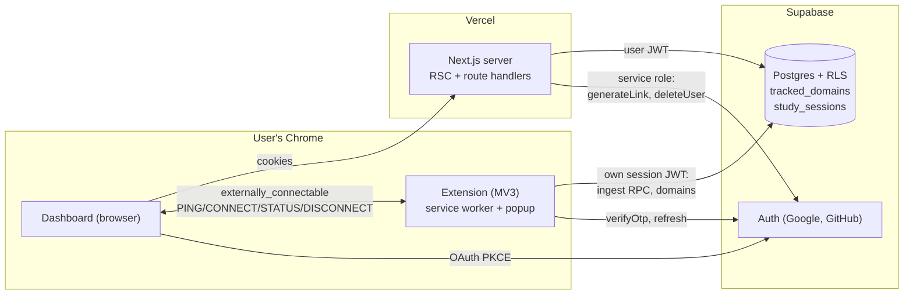
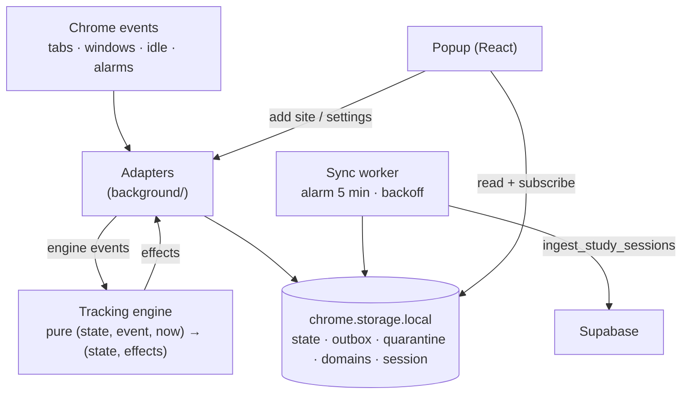
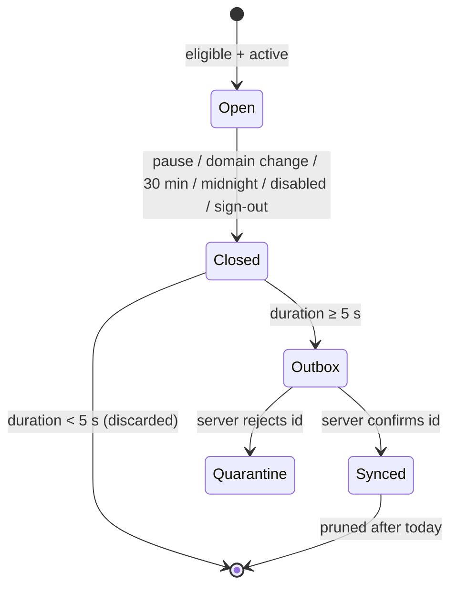

# Architecture (v0)

Status: **Approved** (Gate 2, 2026-11-04). Details live in [`specs/v0`](../specs/v0/) and [`docs/adr`](adr/).

## System context

## Extension internals

Key properties:

- **Engine is pure** (TRK-16): all rules testable with a fake clock; Chrome specifics isolated in adapters.
- **Everything persisted** (TRK-12): the service worker can die at any time.
- **Exactly-once sync** (ADR-0004): client UUIDs + `ON CONFLICT DO NOTHING` + server-confirmed removal from the outbox.
- **Independent sessions** (ADR-0003): dashboard and extension never share refresh tokens.

## Interval lifecycle

