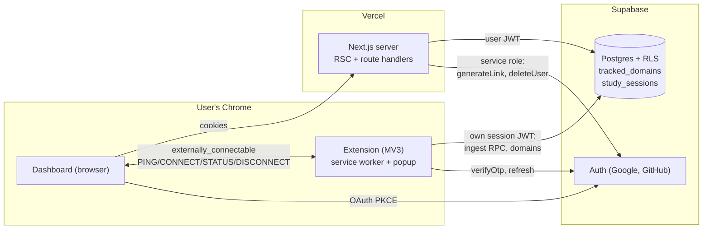
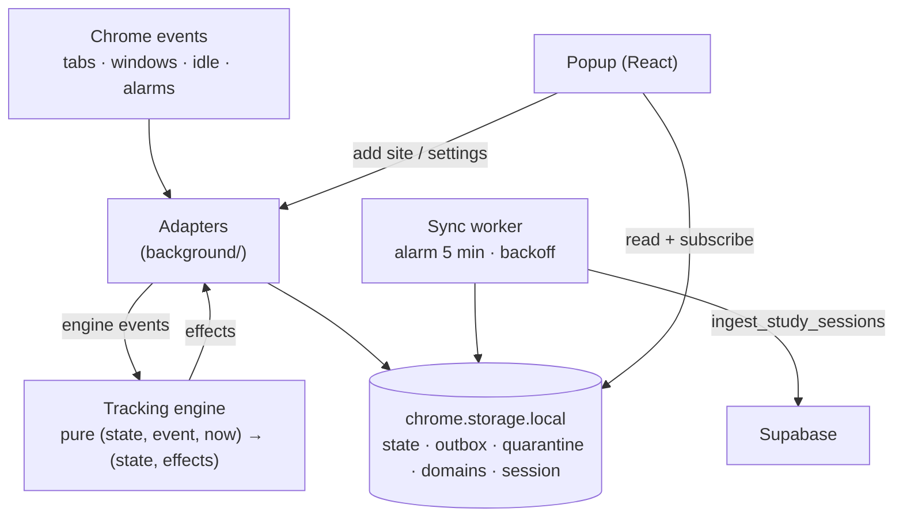
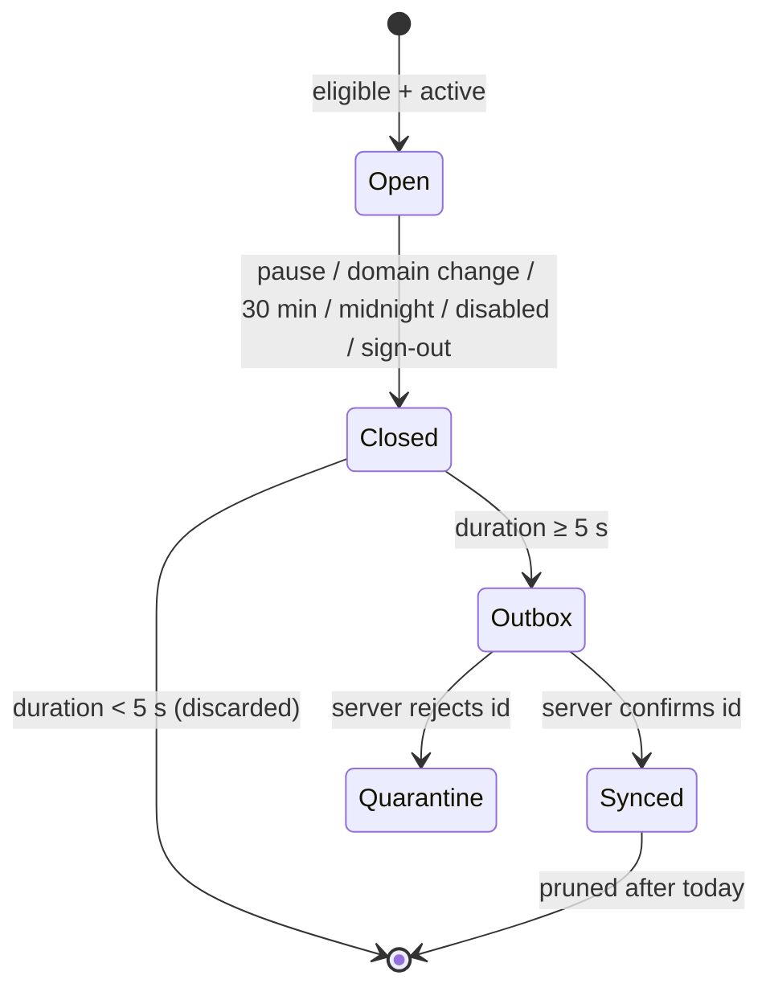

# Architecture (v0)

Status: **Approved** (Gate 2, 2026-11-04). Details live in [`specs/v0`](../specs/v0/) and [`docs/adr`](adr/).

## System context

## Extension internals

Key properties:

- **Engine is pure** (TRK-16): all rules testable with a fake clock; Chrome specifics isolated in adapters.
- **Everything persisted** (TRK-12): the service worker can die at any time.
- **Exactly-once sync** (ADR-0004): client UUIDs + `ON CONFLICT DO NOTHING` + server-confirmed removal from the outbox.
- **Independent sessions** (ADR-0003): dashboard and extension never share refresh tokens.

## Interval lifecycle

## Code organization & conventions

The rule of thumb: **use a pattern when it solves a problem we have now, and make it explicit when we do.** Every abstraction must earn its place; new dependencies and patterns come with a one-line reason in their PR.

### Where code goes

| Path | Contains | Must not contain |
|---|---|---|
| `packages/shared` | Rules and schemas used by **both** apps (domain matching, Zod schemas, constants, formatting) | Browser, Chrome or Node APIs; app-specific code |
| `apps/extension/src/engine` | Pure tracking rules (TRK-16) | Chrome APIs, storage, timers |
| `apps/extension/src/background` | Service worker: Chrome adapters, storage, sync, auth | UI code |
| `apps/extension/src/popup` | Popup UI | Network or Supabase calls (EXT-UI-05a) |
| `apps/web` | Next.js dashboard (routes, components, server code) | Extension logic |
| `supabase/migrations` | Schema, policies, functions — append-only | Edits to applied migrations |
| `supabase/tests/database` | pgTAP tests (`001_helpers` provides shared helpers) | |

Folders are organized **by feature**, not by technical layer (no generic `controllers/`, `services/`, `repositories/`).

### Patterns in use

| Pattern | Where | Why |
|---|---|---|
| **Functional core, imperative shell** (a light form of ports & adapters) | Extension: pure `engine/`, thin `background/` adapters | The trickiest rules (idle, media, midnight, crash recovery) are testable with a fake clock |
| **Transactional outbox + idempotent consumer** | Extension outbox → `ingest_study_sessions` | No lost or duplicated time across retries, offline periods and worker restarts (ADR-0004) |
| **Deny by default** | Database grants, RLS, default privileges | New tables and functions are never exposed by accident; every access is granted explicitly (DATA-04/05) |
| **Database as the final authority** | Domain types, constraints, triggers, single write RPC | Rules hold even if a client is buggy or malicious |
| **Validate at the boundary** | Shared Zod schemas at messages, uploads and user input | Inner code works with trusted, typed data (SEC-10) |
| **Specs as the source of truth** | Requirement IDs in tests; drift tests for constants and the domain regex | Code, spec and database cannot silently disagree |

### Deliberately not used (for now)

Dependency-injection containers · repository/service layers over Supabase · state-management libraries · base classes · build orchestrators (Turborepo/Nx) · a separate backend API. Each is reconsidered when a concrete need appears, through an ADR.
