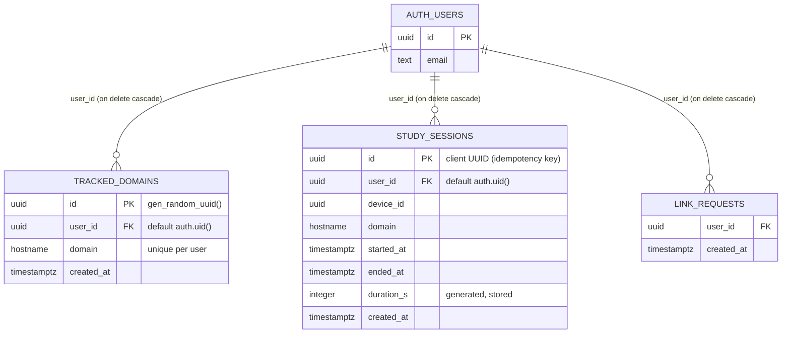

# Database design

Type: living · Owner: tech lead · Last reviewed: 2026-11-11

Low-level design of the Supabase Postgres database in `supabase/`. The rules are in [DATA](../../specs/v0/04-data-model.md) and SEC-07; this page shows how the migrations implement them. The big picture is in the [overview](overview.md).

## Entity relationships

`auth.users` belongs to Supabase Auth. `link_requests` lives in the `private` schema, which PostgREST does not expose.

## Tables and types

| Object | Purpose | Rules in the database | Specs |
|---|---|---|---|
| Domain `public.hostname` | A normalized hostname | ≤ 253 chars, the `DOMAIN_PATTERN` regex, no leading `www.` | TRK-03 |
| `public.tracked_domains` | Study sites per user | `unique (user_id, domain)`; trigger `tracked_domains_limit` allows at most 50 per user (advisory lock per user) | DATA-01, SYNC-09 |
| `public.study_sessions` | One row per closed interval | `ended_at > started_at`; length ≤ 1830 s; immutable | DATA-02, DATA-03 |
| `private.link_requests` | Rate-limit log for extension links | Rows older than 1 hour pruned on each call | AUTH-08 |

`packages/shared/src/db-parity.test.ts` fails if the `hostname` regex or limits drift from `isValidDomain()` in `packages/shared/src/domain.ts`.

## Grants and RLS

Deny by default: the first migration revokes every client privilege and forces RLS; later migrations grant back only what DATA-04/05 allow. Default privileges also revoke access to future tables, sequences and functions, so a new object is never exposed by accident.

| Object | `authenticated` may | Policies |
|---|---|---|
| `tracked_domains` | `select`, `delete`, `insert (domain)` only | `*_select_own`, `*_insert_own`, `*_delete_own`: `user_id = (select auth.uid())`; restrictive `tracked_domains_no_anonymous` |
| `study_sessions` | `select` only | `study_sessions_select_own`; restrictive `study_sessions_no_anonymous` |
| `private.*` | nothing | RLS forced on `link_requests` |
| `anon` | nothing on any table or function | — |

There is no `UPDATE` grant anywhere. `ingest_study_sessions` is the only write path for `study_sessions` (DATA-05, DATA-06).

## Functions (RPC)

| Function | Security | Grant | Does | Specs |
|---|---|---|---|---|
| `ingest_study_sessions(sessions jsonb) → uuid[]` | `definer`, `search_path = ''` | `authenticated` | Rejects no user / anonymous (`PT401`), non-array, > 200 items, > 128 kB (`22023`); per-user advisory lock; abuse caps 1,000/h and 3,500/24 h (`ABUSE_LIMIT`, `PT429`); skips invalid or overlapping elements; inserts with `on conflict (id) do nothing`; returns confirmed ids | DATA-06..09a, SYNC-04, [ADR-0004](../adr/0004-idempotent-ingest.md) |
| `private.parse_study_session(jsonb)` | invoker | none | Validates one element (UUIDs, ISO timestamps with whole seconds, domain, length, ≤ 30 days old, ≤ 5 min in the future); null when invalid | DATA-07 |
| `get_daily_totals(p_from, p_to, p_tz)` | `invoker` (RLS applies) | `authenticated` | One zero-filled row per local day; range ≤ 92 days; checks the time zone (`INVALID_RANGE`, `INVALID_TIME_ZONE`) | DATA-10 |
| `get_domain_totals(p_from, p_to, p_tz)` | `invoker` | `authenticated` | Seconds per domain, largest first | DATA-11 |
| `consume_extension_link_quota() → boolean` | `definer` | `authenticated` | Records one request for `auth.uid()`; false above 5 per minute | AUTH-08 |
| `private.enforce_tracked_domain_limit()` | `definer` | none (trigger) | 50-site limit | DATA-01 |

Account deletion has no RPC: the dashboard calls `auth.admin.deleteUser` with the secret key and the foreign keys cascade to every application row (DATA-12, AUTH-13).

## Indexes

| Index | Serves |
|---|---|
| `tracked_domains_user_domain_key` (unique) | Per-user lookups, duplicates, FK cascade |
| `study_sessions_pkey` (`id`) | Idempotent insert |
| `study_sessions_user_started_idx (user_id, started_at)` | Totals by period, FK cascade |
| `study_sessions_user_created_idx (user_id, created_at)` | Abuse-cap counts |
| `study_sessions_user_device_started_idx (user_id, device_id, started_at)` | Overlap check (DATA-09a) |
| `link_requests_user_created_idx (user_id, created_at)` | Quota count and prune |

## Retention and cleanup

| Data | Kept |
|---|---|
| `tracked_domains`, `study_sessions` | Until the user deletes them (sites) or the account (cascade). No soft delete |
| `private.link_requests` | Rows older than 1 hour are deleted by the next request of the same user |
| Backups | 90 days as encrypted workflow artifacts ([operations §4](../operations.md#4-backups)) |

There is no scheduled job (`pg_cron`) in the database.

## Migrations

Append-only; never edit an applied migration (AGENTS.md).

| File | Adds |
|---|---|
| `20261105100000_core_schema.sql` | `hostname` domain, both tables, 50-site trigger, forced RLS, revokes |
| `20261105110000_rls_policies.sql` | Grants, owner policies, default privileges |
| `20261105120000_ingest_study_sessions.sql` | `parse_study_session`, `ingest_study_sessions`, `created_at` index |
| `20261105130000_totals_rpcs.sql` | `get_daily_totals`, `get_domain_totals` |
| `20261105140000_extension_link_rate_limit.sql` | `link_requests`, `consume_extension_link_quota` |
| `20261110100000_security_hardening.sql` | Upload caps, payload size, overlap check and index, anonymous-refusing policies, bounded totals inputs (#110, #111) |

How they reach production: [release process](../process/release.md#database-migrations).

## Tests (pgTAP)

`pnpm db:test` runs `supabase/tests/database` against the local stack; CI runs it on every pull request (ENV-08).

| File | Covers |
|---|---|
| `000_smoke` | pgTAP runner, schemas, Postgres ≥ 17 |
| `001_helpers` | Shared helpers (test users, role switching) |
| `010_schema` | Tables, types, constraints, trigger (DATA-01..03) |
| `020_rls` | Grants and cross-user isolation (DATA-04/05, SEC-07) |
| `030_ingest` | Ingest validation and idempotency (DATA-06..09, SYNC-04/05) |
| `040_totals` | Totals, time zones, ranges (DATA-10/11, DASH-07) |
| `050_link_quota` | Link rate limit (AUTH-08) |
| `060_security` | Caps, overlaps, payload size, anonymous callers, catalog-wide exposure checks |

## Backups

Weekly data-only dump of `auth.users`, `auth.identities`, `tracked_domains` and `study_sessions`, encrypted with age; restore = migrations + dump. Procedure and checks: [operations §4](../operations.md#4-backups).
