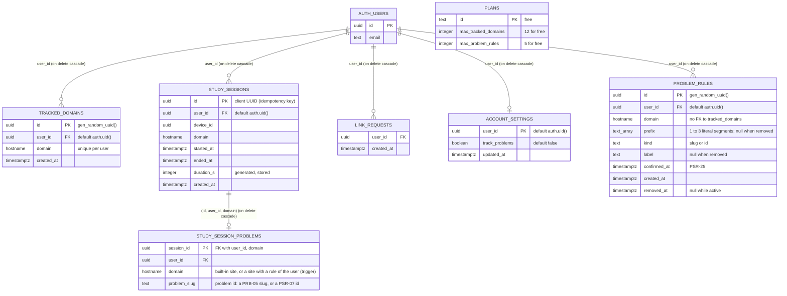

# Database design

Type: living · Owner: tech lead · Last reviewed: 2026-11-27

Low-level design of the Supabase Postgres database in `supabase/`. The rules are in [DATA](../../specs/v0/04-data-model.md), [ENT](../../specs/v1/02-entitlements.md), [PRB](../../specs/v1/01-problems.md) and SEC-07; this page shows how the migrations implement them. The big picture is in the [overview](overview.md).

## Entity relationships

`auth.users` belongs to Supabase Auth. `link_requests` lives in the `private` schema, which PostgREST does not expose. `plans` belongs to no user: it has no foreign key, and in v1 every account is on `free` through `private.plan_of` (no per-account plan record yet, ENT-02).

## Tables and types

| Object | Purpose | Rules in the database | Specs |
|---|---|---|---|
| Domain `public.hostname` | A normalized hostname | ≤ 253 chars, the `DOMAIN_PATTERN` regex, no leading `www.` | TRK-03 |
| `public.tracked_domains` | Study sites per user | `unique (user_id, domain)`; trigger `tracked_domains_limit` allows at most the number in the user's plan (12 on `free`; advisory lock per user; lists already over the limit are kept, deletes always allowed) | DATA-01, ENT-03, SYNC-09 |
| `public.study_sessions` | One row per closed interval | `ended_at > started_at`; length ≤ 1830 s; immutable; `unique (id, user_id, domain)` for the slug FK | DATA-02, DATA-03, DATA-16 |
| `public.account_settings` | One row per user; `track_problems` (off by default, no row = off) | Written only by `set_problem_tracking` | DATA-13, PRB-01 |
| `public.study_session_problems` | Problem id of an interval, deletable while the interval stays | Composite FK `(session_id, user_id, domain)` → `study_sessions (id, user_id, domain)` cascade; column check: ≤ 100 chars matching `PROBLEM_ID_PATTERN` (widened, #285); trigger `study_session_problems_rule_check` (replaces the literal domain check, same `23514`): a domain in `private.problem_domains()` needs a slug (`PROBLEM_SLUG_PATTERN`), another domain needs a rule of the same user and an id of at most `PROBLEM_ID_MAX` (64); a domain with only a removed rule is accepted so a restore can load kept history. Inserted only by ingest v2, deleted only by `set_problem_tracking` (or the account cascade) | DATA-16, PRB-05, PRB-16, PSR-24 |
| `public.problem_rules` | A user's problem rules (PSR-22): domain, literal path prefix (1–3 segments), id kind (`slug` or `id`), label, `confirmed_at`. A removed rule is a tombstone: `removed_at` set, `prefix` and `label` null. No FK from `domain` to `tracked_domains` | Checks on kind, segment pattern and length, prefix count, label length; an active row has prefix and label, a tombstone neither; partial unique index on `(user_id, domain, prefix)` where `removed_at is null`; trigger `problem_rules_limit` (cap from `plans`, error hint `PSR-15`). Written only by `add_problem_rule`, `remove_problem_rule` and `delete_problem_history` | PSR-01, PSR-09, PSR-15, PSR-22, DATA-18 |
| `public.plans` | One row per plan, one column per limit; v1 has `free` with `max_tracked_domains = 12` and `max_problem_rules = 5` (#285). Changed only by a migration (`update public.plans set ... where id = 'free'`) | `id` primary key, `max_tracked_domains > 0`, `max_problem_rules > 0` (not null) | ENT-01 |
| `public.admins` | Users who may open `/admin`. A row means admin; rows are added **by hand in the Supabase SQL editor** by the project owner (no client role can write; no seed, no user id in the repository) | `user_id` primary key → `auth.users` on delete cascade | ADM-01, ADM-02 |
| `private.link_requests` | Rate-limit log for extension links | Rows older than 1 hour pruned on each call | AUTH-08 |

`packages/shared/src/db-parity.test.ts` fails if the `hostname` regex or limits drift from `isValidDomain()` in `packages/shared/src/domain.ts`, (ENT-11) if the `free` row set by the last migration differs from `ENTITLEMENTS` in `packages/shared`, (PSR-15) if `max_problem_rules` of the `free` row differs from `ENTITLEMENTS`, (PSR-06, PSR-07, PSR-01) if the rule limits in `problem_rules` and `add_problem_rule` differ from `PROBLEMS`, and (PRB-05, PRB-18, PSR-24) if the slug or id pattern and length in the parser, the trigger and the stored-id check differ from `PROBLEMS`, or `private.problem_domains()` differs from `PROBLEM_DOMAINS` and `BUILT_IN_PROBLEM_RULES` (the literal domain CHECK was replaced by a trigger in #285, so there is one list in SQL; the parser and the trigger call the function and hold no domain literal).

## Grants and RLS

Deny by default: the first migration revokes every client privilege and forces RLS; later migrations grant back only what DATA-04/05 allow. Default privileges also revoke access to future tables, sequences and functions, so a new object is never exposed by accident.

| Object | `authenticated` may | Policies |
|---|---|---|
| `tracked_domains` | `select`, `delete`, `insert (domain)` only | `*_select_own`, `*_insert_own`, `*_delete_own`: `user_id = (select auth.uid())`; restrictive `tracked_domains_no_anonymous` |
| `plans` | `select` only (no write grant, no write policy) | `plans_select_all` (`using (true)`: no user data); restrictive `plans_no_anonymous` |
| `admins` | `select` only (no write grant, no write policy) | `admins_select_own`: `user_id = (select auth.uid())`; restrictive `admins_no_anonymous` |
| `study_sessions` | `select` only | `study_sessions_select_own`; restrictive `study_sessions_no_anonymous` |
| `account_settings` | `select` only | `account_settings_select_own`; restrictive `account_settings_no_anonymous` |
| `study_session_problems` | `select` only | `study_session_problems_select_own`; restrictive `study_session_problems_no_anonymous` |
| `problem_rules` | `select` only | `problem_rules_select_own`: `user_id = (select auth.uid())` and `removed_at is null` (a tombstone is not readable); restrictive `problem_rules_no_anonymous` |
| `private.*` | nothing | RLS forced on `link_requests` |
| `anon` | nothing on any table or function | — |

There is no `UPDATE` grant anywhere. The two ingest RPCs (one shared implementation) are the only write path for `study_sessions` and `study_session_problems`; `set_problem_tracking` is the only write path for `account_settings` and, with `remove_problem_rule` (delete history) and `delete_problem_history`, one of the paths that delete ids; `add_problem_rule` and `remove_problem_rule` are the only write path for `problem_rules` (DATA-05, DATA-06, DATA-06b, DATA-13, DATA-16, DATA-17, DATA-18).

## Functions (RPC)

| Function | Security | Grant | Does | Specs |
|---|---|---|---|---|
| `ingest_study_sessions(sessions jsonb) → uuid[]` | `definer`, `search_path = ''` | `authenticated` | Released contract (extension ≤ 0.2.3): `private.ingest_sessions(sessions, false)`, returns only the confirmed ids; ignores a `problem` key | DATA-06..09b, SYNC-04, [ADR-0004](../adr/0004-idempotent-ingest.md), [ADR-0011](../adr/0011-ingest-v2.md) |
| `ingest_study_sessions_v2(sessions jsonb) → jsonb` | `definer`, `search_path = ''` | `authenticated` | `private.ingest_sessions(sessions, true)`: `{"confirmed": [id], "rejected": [{"id", "reason": "invalid" \| "future" \| "overlap"}]}`; keeps a valid slug of a newly inserted interval on a `PROBLEM_DOMAINS` site (`leetcode.com`, `neetcode.io`) when the caller's setting is on | DATA-06b, DATA-14, DATA-16 |
| `private.ingest_sessions(sessions jsonb, keep_problem boolean) → jsonb` | invoker (runs as the definer wrappers), `search_path = ''` | none | Shared rules: rejects no user / anonymous (`PT401`), non-array, > 200 items, > 128 kB (`22023`); per-user advisory lock; validates each element and the overlap rule; abuse caps 1,000/h and 3,500/24 h (`ABUSE_LIMIT`, `PT429`) only when the batch has a new row (pure retries pass, DATA-09b); reads the setting after the lock; inserts with `on conflict (id) do nothing` and slug rows only for rows it inserted | DATA-06..09b, DATA-14 |
| `private.parse_session_element(jsonb, boolean)` | invoker | none | Validates one element (UUIDs, ISO timestamps with whole seconds, domain, length, ≤ 30 days old, ≤ 5 min in the future; with `true` also the `problem`: on a built-in domain a slug; on another domain the caller's own rule decides (PSR-23): an active rule needs an id of `PROBLEM_ID_PATTERN` and at most 64 characters (else `invalid`), only a removed rule stores the time and drops the id, no rule is `invalid`); returns the columns and a reason (`invalid`, `future`, or null when valid). Replaced `parse_study_session` in #178 | DATA-07, DATA-06b, PRB-05, PSR-23 |
| `add_problem_rule(p_domain, p_prefix, p_kind, p_label, p_confirmed) → uuid` | `definer`, `search_path = ''` | `authenticated` | Under the per-user ingest lock: refuses without `p_confirmed = true` (`CONFIRMATION_REQUIRED`), a domain that is not a normalized hostname (`INVALID_DOMAIN`) or not tracked by the caller (`DOMAIN_NOT_TRACKED`, exact match), a built-in domain (`BUILT_IN_DOMAIN`), a prefix outside 1–3 lower-case segments of at most 40 characters (`INVALID_PREFIX`), an unknown kind (`INVALID_KIND`), a label over 40 characters (`INVALID_LABEL`; blank = the domain), a duplicate active prefix (`23505` `DUPLICATE_RULE`); deletes the tombstones of the domain; the insert trigger enforces the cap. Refusals are `22023` with the code as message. Returns the rule id | PSR-01..09, PSR-15, PSR-16, PSR-25 |
| `remove_problem_rule(p_rule_id, p_delete_history) → void` | `definer`, `search_path = ''` | `authenticated` | Under the per-user ingest lock: keep history turns the active rule into a tombstone (`removed_at` set, `prefix` and `label` cleared); delete history first deletes the stored ids of that domain and its older tombstones, then leaves the same tombstone (queued intervals keep their time, PSR-23 step 4). Unknown, foreign or already removed rule: `PT404` `NOT_FOUND` | PSR-13, PSR-22 |
| `delete_problem_history(p_domain) → void` | `definer`, `search_path = ''` | `authenticated` | Under the per-user ingest lock: deletes the caller's stored ids of one domain and that domain's tombstones; never touches `study_sessions`, totals or other domains | PSR-13, PSR-24 |
| `private.delete_problem_domain_history(p_user_id, p_domain)` | `definer` | none | The delete shared by the two RPCs above | PSR-13 |
| `private.check_problem_row()` | `definer` (trigger) | none | `before insert` on `study_session_problems`: built-in domain → slug; another domain → a rule of the row's user and an id of at most 64 characters; else `23514` (same SQLSTATE as the old domain CHECK) | PSR-24, DATA-16 |
| `private.enforce_problem_rule_limit()` | `definer` (trigger) | none | `before insert` on `problem_rules`: reads `max_problem_rules` of `plan_of(new.user_id)`; refuses at or above it with `P0001`, hint `PSR-15`, detail `{"code":"LIMIT_REACHED","limit":5,"plan":"free","kind":"problem_rules"}`; a missing plan row refuses (fail closed) | PSR-15, ENT-03, ENT-05 |
| `set_problem_tracking(p_enabled, p_delete_history)` | `definer`, `search_path = ''` | `authenticated` | Same per-user lock as ingest; upserts the caller's setting; with `(false, true)` deletes every slug row of the caller; `(true, true)` and nulls refused (`INVALID_ARGUMENT`, `22023`); never touches `study_sessions` | DATA-17, PRB-16 |
| `get_daily_totals(p_from, p_to, p_tz)` | `invoker` (RLS applies) | `authenticated` | One zero-filled row per local day; range ≤ 92 days; checks the time zone (`INVALID_RANGE`, `INVALID_TIME_ZONE`) | DATA-10 |
| `get_domain_totals(p_from, p_to, p_tz)` | `invoker` | `authenticated` | Seconds per domain, largest first | DATA-11 |
| `private.problem_domains() → text[]` | invoker, `immutable`, `search_path = ''` | none | The one SQL list of sites that can carry a problem slug (`PROBLEM_DOMAINS`); read by `private.parse_session_element`; also read by `private.check_problem_row` and `add_problem_rule` (the literal CHECK was dropped in #285). Changing it is a new migration | PRB-18, DATA-16 |
| `get_problem_totals_v2(p_from, p_to, p_tz)` | `invoker`, `stable`, `search_path = ''` | `authenticated` | Seconds and last local day per site and slug, returning `domain`; same checks as DATA-10; the same slug on two sites is two rows; ties by domain, then slug (byte order); at most 200 rows | DATA-15a, PRB-11, PRB-19 |
| `consume_extension_link_quota() → boolean` | `definer` | `authenticated` | Records one request for `auth.uid()`; false above 5 per minute | AUTH-08 |
| `private.plan_of(p_user_id uuid) → text` | `invoker`, `search_path = ''` | none | Plan of a user; `'free'` for everyone in v1. A later per-account plan changes only this function | ENT-02, ENT-12 |
| `private.enforce_tracked_domain_limit()` | `definer` | none (trigger) | Site limit: reads `max_tracked_domains` of `plan_of(new.user_id)` from `plans`; refuses the insert at or above it; a missing plan row refuses too (fail closed) | DATA-01, ENT-03, ENT-05 |

### Limit error (ENT-05, ENT-06; PSR-15 for problem rules)

When the site limit is reached, the trigger raises:

| Field | Value |
|---|---|
| `errcode` | `P0001` (unchanged; PostgREST answers HTTP 400) |
| `hint` | `DATA-01` (unchanged; released extension 0.2.3 maps it to `LIMIT_REACHED`) |
| `message` | `A user can track at most 12 domains` (same format; the number comes from the plan) |
| `detail` | `{"code":"LIMIT_REACHED","limit":12,"plan":"free"}` (new; PostgREST returns it as `details`) |

The cap on problem rules raises the same shape from `problem_rules_limit`: message `A user can add at most 5 problem rules`, `hint` `PSR-15`, and `kind: "problem_rules"` added to `detail`.

New fields are only added to `detail`, so older clients are unaffected. New clients read it with `LimitErrorDetailsSchema` / `parseLimitErrorDetails` in `packages/shared` and fall back to the hint when `details` is missing or invalid (ENT-07). The trigger runs on insert only, so a list already over the limit stays and its owner can still remove sites.

Account deletion has no RPC: the dashboard calls `auth.admin.deleteUser` with the secret key and the foreign keys cascade to every application row (DATA-12, AUTH-13).

## Indexes

| Index | Serves |
|---|---|
| `tracked_domains_user_domain_key` (unique) | Per-user lookups, duplicates, FK cascade |
| `study_sessions_pkey` (`id`) | Idempotent insert |
| `study_sessions_user_started_idx (user_id, started_at)` | Totals by period, FK cascade |
| `study_sessions_user_created_idx (user_id, created_at)` | Abuse-cap counts |
| `study_sessions_user_device_started_idx (user_id, device_id, started_at)` | Overlap check (DATA-09a) |
| `study_sessions_id_user_domain_key` (unique `id, user_id, domain`) | Target of the slug FK (DATA-16); built with a plain `CREATE` inside the migration transaction |
| `study_session_problems_pkey` (`session_id`) | One slug per interval; join in `get_problem_totals_v2` |
| `study_session_problems_user_idx (user_id)` | History delete, RLS, FK cascade |
| `problem_rules_active_key` (unique `user_id, domain, prefix` where `removed_at is null`) | No duplicate prefix among active rules; removed rows never block a re-add (PSR-09) |
| `problem_rules_user_domain_idx (user_id, domain)` | Rule lookup of ingest (active or removed), history delete, FK cascade |
| `link_requests_user_created_idx (user_id, created_at)` | Quota count and prune |

## Retention and cleanup

| Data | Kept |
|---|---|
| `tracked_domains`, `study_sessions` | Until the user deletes them (sites) or the account (cascade). No soft delete |
| `study_session_problems` | Until the user turns the setting off with "delete history" (PRB-16) or deletes the account |
| `account_settings` | Until the account is deleted |
| `problem_rules` | Active rules until the user removes them or deletes the account; a tombstone (no prefix, no label) until the user deletes that domain's history, adds a rule on the domain again, or deletes the account |
| `private.link_requests` | Rows older than 1 hour are deleted by the next request of the same user |
| Backups | 90 days as encrypted workflow artifacts ([operations §4](../operations.md#4-backups)) |

There is no scheduled job (`pg_cron`) in the database.

## Migrations

Append-only; never edit an applied migration (AGENTS.md).

| File | Adds |
|---|---|
| `20261105100000_core_schema.sql` | `hostname` domain, both tables, site-limit trigger (50, lowered to 12 by `20261112100000`), forced RLS, revokes |
| `20261105110000_rls_policies.sql` | Grants, owner policies, default privileges |
| `20261105120000_ingest_study_sessions.sql` | `parse_study_session`, `ingest_study_sessions`, `created_at` index |
| `20261105130000_totals_rpcs.sql` | `get_daily_totals`, `get_domain_totals` |
| `20261105140000_extension_link_rate_limit.sql` | `link_requests`, `consume_extension_link_quota` |
| `20261110100000_security_hardening.sql` | Upload caps, payload size, overlap check and index, anonymous-refusing policies, bounded totals inputs (#110, #111) |
| `20261112100000_tracked_domain_limit_12.sql` | Site limit 50 → 12; existing rows kept (#145) |
| `20261117100000_entitlements.sql` | `plans` (`free` = 12), `private.plan_of`, site-limit trigger reads the plan and raises the error with `detail` (#177) |
| `20261118100000_ingest_v2.sql` | `account_settings`, `study_session_problems`, `private.ingest_sessions` behind `ingest_study_sessions` and the new `ingest_study_sessions_v2`, caps only for new rows, `set_problem_tracking`, `get_problem_totals` (dropped in `20261127100000`); drops `parse_study_session` (#178, ADR-0011) |
| `20261118110000_admins.sql` | `admins` (ADM-01): own-row read only, no client write, rows added by hand (#213, ADR-0013) |
| `20261120100000_problem_domains.sql` | Expand step of NeetCode problems: `private.problem_domains()`, the widened domain check, the v2 element parser reads the list, `get_problem_totals_v2`; `get_problem_totals` unchanged until the contract step (#237, #233, PRB-18..20) |
| `20261127100000_drop_get_problem_totals.sql` | Contract step: drops `get_problem_totals(date, date, text)`; `get_problem_totals_v2` is the only per-problem totals function (#241, NC-e, DATA-15a) |
| `20261127200000_problem_rules.sql` | Expand step of user problem rules: `plans.max_problem_rules`, `problem_rules` and its RPCs (add, remove, per-domain history delete), the cap trigger, the widened stored-id check, the insert trigger that replaces the domain CHECK, the v2 parser checks ids by rule (#285, PS-a, PSR-15..25) |

How they reach production: [release process](../process/release.md#database-migrations).

## Tests (pgTAP)

`pnpm db:test` runs `supabase/tests/database` against the local stack; CI runs it on every pull request (ENV-08).

| File | Covers |
|---|---|
| `000_smoke` | pgTAP runner, schemas, Postgres ≥ 17 |
| `001_helpers` | Shared helpers (test users, role switching) |
| `010_schema` | Tables, types, constraints, trigger (DATA-01..03) |
| `020_rls` | Grants and cross-user isolation (DATA-04/05, SEC-07) |
| `030_ingest` | Ingest validation and idempotency (DATA-06..09, SYNC-04/05) |
| `040_totals` | Totals, time zones, ranges (DATA-10/11, DASH-07) |
| `050_link_quota` | Link rate limit (AUTH-08) |
| `060_security` | Caps, overlaps, payload size, anonymous callers, catalog-wide exposure checks |
| `070_domain_limit` | 12-site limit; lists over the limit can delete, not insert (DATA-01, #145) |
| `090_rls_policies` | Every policy ties access to the caller; `plans` is the one read-only reference exception (SEC-07, ENT-01) |
| `100_entitlements` | `plans`, `plan_of`, limit from the plan, error code, hint and details, changed `free` row (ENT-01..06) |
| `110_ingest_v2` | ADR-0011 compatibility plan items 1–3, 6, 7: old contract, v2 reasons and slugs, shared rules and caps for pure retries, grants, setting and history delete, problem totals (DATA-06b, DATA-09b, DATA-13..17) |
| `120_admins` | `admins`: own row only, no client insert, update or delete, anonymous refusal, cascade (ADM-01) |
| `130_problem_domains` | The widened check and the one list, v2 ingest of `neetcode.io` and of domains outside the list (only that element `invalid`), old clients (0.2.3, 0.3.0), `get_problem_totals_v2` with two sites and its grants (invoker, authenticated only), the old function is gone, RLS, history delete across sites (PRB-16, PRB-18..20, DATA-15a) |
| `140_problem_rules` | Rule insert checks (tracked, built-in, lookalike, prefix, kind, label, confirmation, duplicate), cap and `PSR-15` error, grants, RLS, tombstone and re-add, per-domain delete, ingest by rule (the five cases of PSR-23), the insert trigger, account deletion, extension 0.2.3 / 0.3.0 / 0.3.1 fixtures (PSR-01..25, PRB-20) |

## Backups

Weekly data-only dump of `auth.users`, `auth.identities`, `tracked_domains`, `study_sessions`, `account_settings`, `study_session_problems`, `problem_rules` and `admins` (`plans` comes from the migrations), encrypted with age; restore = migrations + dump. Procedure and checks: [operations §4](../operations.md#4-backups).
