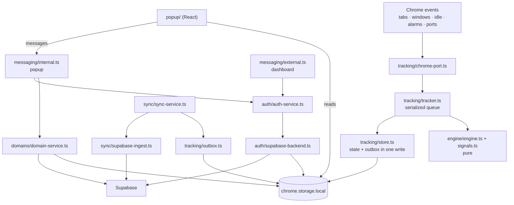
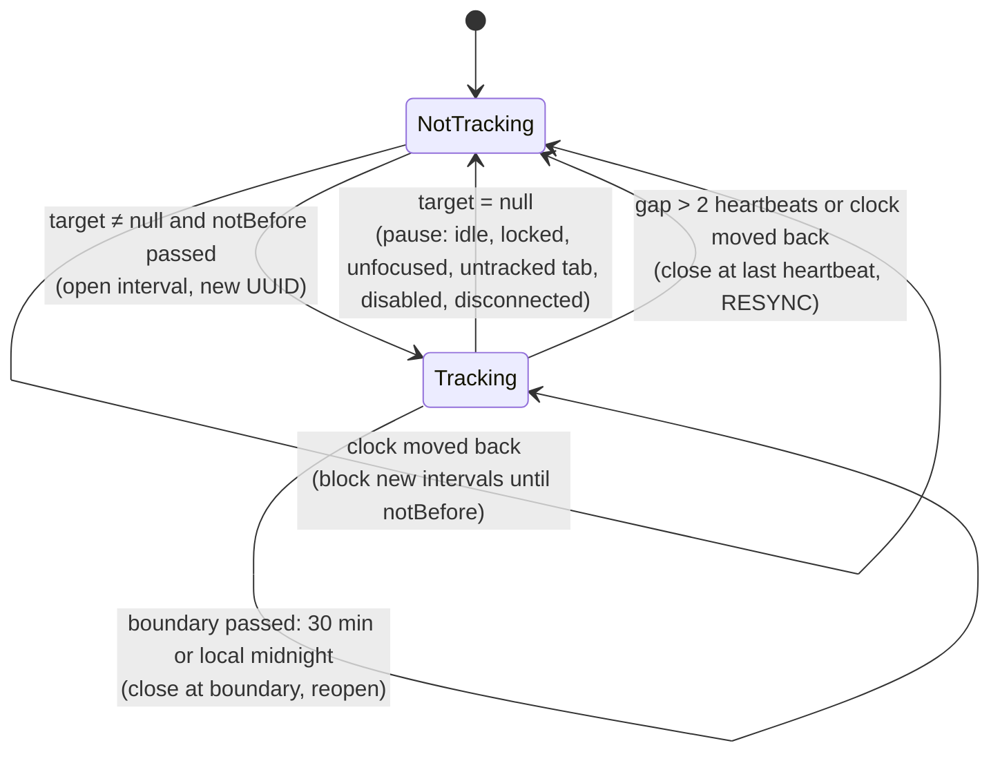
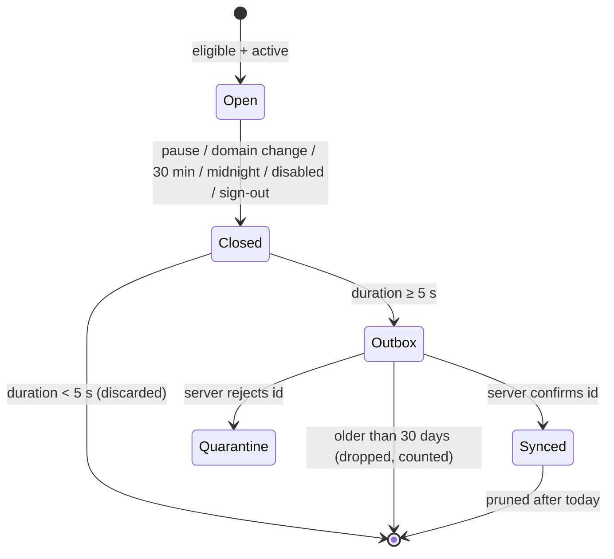
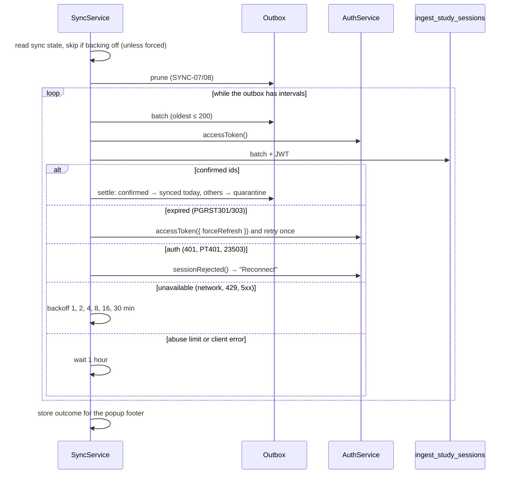

# Extension design

Type: living · Owner: tech lead · Last reviewed: 2026-11-11

Low-level design of the Chrome MV3 extension in `apps/extension`. Rules are in [TRK](../../specs/v0/01-tracking.md), [AUTH](../../specs/v0/02-auth.md), [SYNC](../../specs/v0/03-sync.md), [EXT-UI](../../specs/v0/05-extension-ui.md) and [STORE](../../specs/store/00-chrome-web-store.md). The big picture is in the [overview](overview.md).

## Module map

| Path (`src/`) | Role | Main specs |
|---|---|---|
| `engine/signals.ts` | Engine A: folds Chrome observations into `Signals` and decides the tracking target | TRK-01..07 |
| `engine/engine.ts` | Engine B: `step(state, event, now, env) → { state, effects }`; opens, splits and closes intervals | TRK-08..16 |
| `background/index.ts` | Service worker entry: wires every module and registers all listeners synchronously | TRK-19, SYNC-02 |
| `background/tracking/chrome-port.ts` | Chrome adapter: tab, focus (500 ms debounce), idle, heartbeat alarm, popup port | TRK-02, 04, 06, 13, 18, 19 |
| `background/tracking/tracker.ts`, `queue.ts` | One serialized queue; each slot loads state, steps the engine, commits, answers re-query effects; 10 s slot timeout | TRK-12, 13, 17 |
| `background/tracking/store.ts`, `keys.ts` | Storage schemas and keys; engine state and outbox written together | TRK-12, SYNC-01 |
| `background/tracking/outbox.ts` | Outbox, quarantine, synced-today, prune and counts | SYNC-01, 05, 07, 08 |
| `background/tracking/bootstrap.ts` | Start sequence; storage changes become engine events; `LocalData` hooks for auth | TRK-01, 19, AUTH-11/12 |
| `background/tracking/device.ts` | Random device id, UUID generator, local-midnight calendar | TRK-09, 10 |
| `background/sync/sync-service.ts` | Upload cycle, backoff, outcome stored for the popup | SYNC-02..08 |
| `background/sync/supabase-ingest.ts` | Calls `ingest_study_sessions`; maps errors to classes | SYNC-06, DATA-06..09 |
| `background/auth/auth-service.ts` | Connect, token refresh, session rejected, disconnect, forget local data; one lock | AUTH-07b, 10..12 |
| `background/auth/supabase-backend.ts`, `storage.ts`, `mutex.ts` | supabase-js session in `chrome.storage.local`; in-memory lock | AUTH-10, ADR-0002 |
| `background/account-epoch.ts` | In-memory counter of account changes; stale work writes nothing | SYNC-02a, AUTH-11 |
| `background/domains/` | Tracked-site cache and server edits | SYNC-09..11 |
| `background/messaging/external.ts` | Messages from the dashboard origin | AUTH-06..07b, SEC-05 |
| `background/messaging/internal.ts` | Messages from the extension's own pages | EXT-UI-05a, SEC-05 |
| `background/api/data-client.ts` | supabase-js data client that asks `AuthService` for each token | AUTH-10 |
| `background/badge.ts`, `lib/badge.ts` | Toolbar badge from the engine state | EXT-UI-10 |
| `popup/` | React popup: `App.tsx`, `views/` (Main, Settings), `components/`, `ui/` primitives, `data.ts` (storage reads + commands) | EXT-UI-01..10 |
| `lib/` | Code shared by worker and popup: `popup-messages.ts`, `popup-view.ts` (pure view model), `sync-state.ts`, `log.ts`, `config.ts`, `env.ts` | EXT-UI-05a, ENV-10 |

The engine has no Chrome API, storage or timer; everything Chrome-specific stays in `background/` (functional core, imperative shell). The popup has no Supabase client (EXT-UI-05a).

## Tracking state machine

The engine keeps at most one open interval. `trackingTarget(signals)` is the tracked domain being studied now, or `null`.

The target is non-null only when all of TRK-01 hold (connected, tracking on, domain list loaded, focused tracked tab) and the user is active, or idle with the media hold (TRK-05, TRK-06, [ADR-0005](../adr/0005-media-activity.md)). Every step persists the state (TRK-12).

What happens to a closed interval:

## Sync cycle

`SyncService.run` allows one cycle at a time. It starts from the `careeros.sync` alarm, on every worker start and when a session is written (SYNC-02).

If the account epoch changed during the cycle (connect, session rejected, local data cleared), the cycle writes nothing (SYNC-02a). Data is never discarded on failure.

## Message protocol

### Popup → service worker

Validated by `PopupRequestSchema` (`lib/popup-messages.ts`). Accepted only from the extension's own pages (`sender.id` and a `chrome-extension://<id>/` URL); anything else gets no reply.

| Type | Payload | Reply |
|---|---|---|
| `AUTH_STATUS` | — | `{ connected, email, needsReconnect }` (never a token) |
| `DOMAINS_REFRESH` | — | `{ ok: true, domains }` or `{ ok: false, error }` |
| `DOMAINS_ADD` | `input` (≤ 2048 chars) | same |
| `DOMAINS_REMOVE` | `domain` (≤ 253 chars) | same |
| `TRACKING_SET` | `enabled` | `{ ok: true }` |
| `DISCONNECT` | `discardUnsynced` | `{ ok: true }`, `UNSYNCED_DATA` with `pending`, or `FAILED` |
| `FORGET_LOCAL_DATA` | — | `{ ok: true }`, `CONNECTED` or `FAILED` |

Domain errors: `NOT_CONNECTED`, `INVALID_DOMAIN`, `LIMIT_REACHED`, `UNAVAILABLE`. While shown, the popup also holds the port `careeros.popup`, so the worker treats Chrome as focused (TRK-18).

### Dashboard → service worker

Validated by `ExtensionRequestSchema` (`packages/shared/src/schemas.ts`). Chrome delivers only messages from the `externally_connectable` origin; the handler checks `sender.origin` again and ignores other extensions (AUTH-06/07). Every message carries `protocolVersion`; this build supports `1` (`PROTOCOL_VERSION`).

| Type | Payload | Success reply |
|---|---|---|
| `PING` | — | `{ ok, protocolVersion, extensionVersion, connected, email? }` |
| `STATUS` | — | same as `PING` |
| `CONNECT` | `tokenHash` (16–512 chars) | `{ ok, protocolVersion, email? }` |
| `DISCONNECT` | — | `{ ok, protocolVersion }` |

| Error code | When |
|---|---|
| `UNSUPPORTED_PROTOCOL` | `protocolVersion` not supported (AUTH-07a) |
| `INVALID_TOKEN` | `verifyOtp` failed (expired, used, wrong) |
| `ALREADY_CONNECTED` | `CONNECT` for a different user while connected (AUTH-07b) |
| `UNSYNCED_DATA` | Another user's unsynced intervals are on this device, or `DISCONNECT` left intervals unsynced (AUTH-11/12) |
| `INTERNAL` | Unexpected failure; no details |

Invalid messages get no reply at all. From the dashboard, `DISCONNECT` never discards unsynced data.

## Storage keys

All in `chrome.storage.local` ([ADR-0002](../adr/0002-extension-storage.md)). `Forget local data`, disconnect and an account change clear the account's keys (AUTH-11/12, SEC-14).

| Key | Holds | Cleared with account data |
|---|---|---|
| `careeros.auth.session` | supabase-js session (access + refresh token) | yes (sign-out) |
| `careeros.auth.dataOwner` | User id that owns the local data | yes |
| `careeros.auth.needsReconnect` | Session became invalid; popup shows "Reconnect" | yes |
| `careeros.tracking.engine` | Engine state (signals, open interval, checkpoints) | yes |
| `careeros.tracking.outbox` | Closed intervals waiting for upload | yes |
| `careeros.tracking.quarantine` | Intervals the server rejected | yes |
| `careeros.tracking.syncedToday` | Today's confirmed intervals, for popup totals | yes |
| `careeros.tracking.droppedCount` | Intervals dropped as too old | yes |
| `careeros.domains.cache` | Tracked-domain list | yes (also when the session becomes invalid) |
| `careeros.sync.state` | Backoff, last outcome, last sync time | yes |
| `careeros.device.id` | Random device id | replaced when local data is cleared |
| `careeros.settings.trackingEnabled` | Per-device switch; missing means on | no |

## Alarms and timers

| Name | Period | Purpose |
|---|---|---|
| `careeros.heartbeat` | `HEARTBEAT_PERIOD_MIN` (1 min) | Re-check tab, focus, idle and media; detects gaps (TRK-13/14) |
| `careeros.sync` | `SYNC_PERIOD_MIN` (5 min) | Sync cycle (SYNC-02) |
| Focus debounce | 500 ms (`FOCUS_DEBOUNCE_MS`) | Ignore short `WINDOW_ID_NONE` reports (TRK-18) |
| Tracker slot timeout | 10 s (`SLOT_TIMEOUT_MS`) | A hung Chrome API cannot freeze the queue |

`chrome.idle.setDetectionInterval(60)` is set on every worker start (TRK-19).

## Build modes and manifest

`manifest.config.ts` builds `manifest.json` per mode; `vite.config.ts` injects the public build config (`__CAREEROS_CONFIG__`).

| | development | production |
|---|---|---|
| Command | `pnpm build` (+ `scripts/check-worker.ts`) | `pnpm build:prod` |
| Output | `dist/development` | `dist/production` |
| Name | CareerOS (dev) | CareerOS |
| ID (`MANIFEST_KEYS`) | `jfklbpedlpkginmdfckogdgaggmdmkbk` | `pddbflgidjmnhidineoejneeipaicgek` (the store item's key, STORE-05) |
| `VITE_DASHBOARD_ORIGIN` | defaults to `http://localhost:3000` | required, https |
| `VITE_SUPABASE_URL`, `VITE_SUPABASE_PUBLISHABLE_KEY` | optional ("not configured") | required; key must be `sb_publishable_…` |
| Debug logs | on | off |

Every build: `minimum_chrome_version` 120, permissions exactly `alarms`, `idle`, `storage`, `tabs` (SEC-03), CSP `script-src 'self'; object-src 'self'` (SEC-04), `externally_connectable` = the dashboard origin only (AUTH-06). `assertNoSecrets` fails the build on a value that looks like a secret (SEC-07).

Packages (`scripts/zip.ts`):

| Script | Zip | Use |
|---|---|---|
| `release` | `careeros-extension-<version>.zip` | Unpacked production build, keeps the `key` (GitHub Release) |
| `release:store` | `careeros-extension-<version>-store.zip` | Chrome Web Store: same build without `key` (STORE-01) |

The version comes from `apps/extension/package.json`. Release steps: [release process](../process/release.md#extension).

## Tests

Unit tests sit next to the code (`*.test.ts`). `tests/integration` runs against the local Supabase stack; `tests/e2e` loads the built extension in Chromium with Playwright and drives the dashboard, including its responsive layout checks; `tests/responsive` checks the landing page's layout without a backend; both use `tests/support/responsive.ts` (TEST-01). See [TEST](../../specs/v0/08-testing.md).
