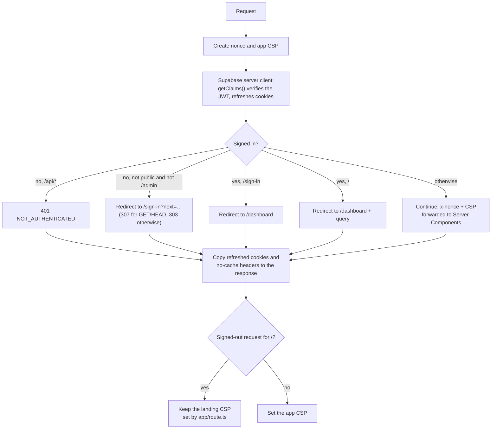

# Web app design

Type: living · Owner: tech lead · Last reviewed: 2026-11-18

Low-level design of `apps/web`: the Next.js dashboard and the public landing page, deployed on Vercel. Rules are in [AUTH](../../specs/v0/02-auth.md), [DASH](../../specs/v0/06-dashboard.md), [SEC](../../specs/v0/07-security-privacy.md) and [LAND](../../specs/landing/00-landing.md). The big picture is in the [overview](overview.md).

The browser never calls Supabase. Every Supabase call runs on the server with the user's cookie session or, in two routes, the secret key.

## Route map

| Route | Kind | Access | What it does | Specs |
|---|---|---|---|---|
| `/` | Route handler `app/route.ts` (static) | Public; signed-in visitors are redirected to `/dashboard` | Landing page HTML with its own CSP | LAND-01, 02, 06 |
| `/dashboard` | Server Component `app/(app)/dashboard` | Session | Cards, daily bar chart, platform donut for `?view=week|month&date=` | DASH-04..11, 15 |
| `/settings` | Server Component `app/(app)/settings` | Session | Tracked sites, extension status, account | DASH-12..14 |
| `/connect` | Server Component + client `connect-extension.tsx` | Session | Connects the extension (PING → link → CONNECT) | AUTH-06..09 |
| `/sign-in` | Page | Public; signed-in → `/dashboard` | Google and GitHub buttons | AUTH-01 |
| `/privacy` | Page | Public | Privacy notice from `PRIVACY_*` env | SEC-13 |
| `/admin` | Server Component `app/admin` (layout guard, `force-dynamic`) | Signed in **and** a row in `admins`; everyone else gets the 404 page, never a redirect | Four overview cards (v1 progress, production health, agent cost, skills used) and folded Details for reviews, sessions and docs, from the private ledger and GitHub; read-only, `noindex`, not in the sitemap, linked from nowhere | ADM-02..20, [ADR-0013](../adr/0013-admin-access.md) |
| `POST /auth/sign-in` | Route handler | Public, same origin | Starts OAuth PKCE; GitHub asks for `user:email` | AUTH-01, 05 |
| `GET /auth/callback` | Route handler | Public | Exchanges the code for cookies; `next` via `safeNextPath` | AUTH-01..03 |
| `POST /auth/sign-out` | Route handler | Same origin | `scope=local`, or `global` for all devices | AUTH-04, 12a |
| `POST /api/extension/link` | Route handler | Session, same origin | Single-use token hash; 5/min quota; secret key | AUTH-08, 09 |
| `POST /api/sites` | Route handler | Session, same origin | Adds a tracked site (normalized); duplicate = success; at the limit `422 {error, limit, plan}` read from the database error's `details` (`parseLimitErrorDetails`) | DASH-12, DATA-01, ENT-08 |
| `DELETE /api/sites/[id]` | Route handler | Session, same origin | Removes a tracked site | DASH-12 |
| `PUT /api/settings/problems` | Route handler | Session, same origin | Turns **Track coding problems** (**Track LeetCode problems** while the store has only 0.3.0) on or off (404 until the store extension is 0.3.0 or newer, PRB-23); `deleteHistory` only with `enabled: false`; calls `set_problem_tracking` | DASH-16, PRB-16, DATA-17 |
| `POST /api/settings/problem-rules` | Route handler | Session, same origin | Adds a problem rule (`domain`, `prefix`, `kind: id`, `label`, `confirmedProblemId: true`) through `add_problem_rule`; the example URL is never part of the body and nothing from the body is logged (PSR-11); cap `422 LIMIT_REACHED` with the limit from the error, duplicate `409`, other refusals `400` with the database's code; `404` until the store has extension 0.4.0 | DASH-16, PSR-11..16, PSR-25 |
| `DELETE /api/settings/problem-rules/[id]` | Route handler | Session, same origin | Removes a rule through `remove_problem_rule`; body `{ deleteHistory }` keeps or deletes the stored ids of its domain (study time stays); `404` for a rule that is not the caller's or already removed, and until the store has 0.4.0 | DASH-16, PSR-13, PSR-22 |
| `POST /api/account/delete` | Route handler (form, sent with `fetch` by Settings) | Session, same origin, sign-in < 10 min | `admin.deleteUser`, clears cookies; Settings follows its redirect, or goes to sign-in on the proxy's 401 (#78) | DASH-14, AUTH-13, 14 |
| `/robots.txt`, `/sitemap.xml` | `app/robots.ts`, `app/sitemap.ts` | Public | Disallow `/api/`, `/auth/`; sitemap lists `/` and `/privacy` | LAND-07 |
| `/opengraph-image`, `/icon.svg`, `/apple-icon.png`, `/fonts/*` | Generated image, static files | Public | Share image, favicon (logo mark), Apple touch icon, self-hosted fonts | LAND-04, 07 |

Public paths are listed in `lib/auth/routes.ts` (`PUBLIC_PATHS`, `PUBLIC_EXACT_PATHS`). App pages carry `noindex` (`app/layout.tsx`).

## Request pipeline (`proxy.ts`)

The proxy runs on every request except `_next/static`, `_next/image` and `favicon.ico`. Prefetch requests are not excluded.

Redirect targets use `SITE_URL`, never the `Host` header (SEC-08).

## Security policies

`next.config.ts` adds the static headers to every response: `X-Frame-Options: DENY`, `X-Content-Type-Options: nosniff`, `Referrer-Policy: strict-origin-when-cross-origin`, a `Permissions-Policy` that denies camera, microphone, geolocation and payment, `Cross-Origin-Opener-Policy` and `Cross-Origin-Resource-Policy: same-origin`, and HSTS in production over https (SEC-09).

| Directive | App pages (`lib/security/headers.ts`) | Landing `/` (`lib/landing/csp.ts`) |
|---|---|---|
| `default-src` | `'self'` | `'none'` |
| `script-src` | `'self' 'nonce-…' 'strict-dynamic'` (+ `'unsafe-eval'` in dev); covers the analytics script, inserted by a nonce'd bundle | `'none'`; with analytics: `<site>/_vercel/insights/script.js` only |
| `style-src` | `'self' 'nonce-…'` (`'unsafe-inline'` in dev); Radix's scroll-lock `<style>` gets the nonce through `get-nonce`, set by `ThemeProvider` (#68) | `'sha256-…'` of the one inline `<style>` |
| `style-src-attr` | `'unsafe-inline'` | `'unsafe-inline'` |
| `img-src` | `'self' blob: data:` | `'self' data:` |
| `font-src` | `'self'` | `'self'` |
| `connect-src` | `'self'` (includes `/_vercel/insights/*`) | (default `'none'`); with analytics: `<site>/_vercel/insights/` |
| `object-src` | `'none'` | (default `'none'`) |
| `base-uri` | `'self'` | `'none'` |
| `form-action` | `'self'`, the Supabase origin, Google, GitHub | `'none'` |
| `frame-ancestors` | `'none'` | `'none'` |
| `upgrade-insecure-requests` | when `SITE_URL` is https | when the site is https |
| Rendering | Per request (nonce) | Built once (`force-static`) |

Why two policies: [ADR-0009](../adr/0009-landing-route-and-rendering.md). "With analytics" means Vercel Web Analytics is enabled, which happens only on production deployments on Vercel (`isAnalyticsEnabled()` in `lib/analytics/config.ts`, SEC-15, [ADR-0010](../adr/0010-web-analytics.md)); the app CSP is the same either way. Mutating routes also check `Origin` against `SITE_URL` (`lib/security/origin.ts`, SEC-08); session cookies are `HttpOnly`, `SameSite=Lax`, `Secure` on https (`lib/supabase/cookies.ts`, AUTH-02).

## Data access

| Client | File | Key | Used by |
|---|---|---|---|
| Server client (per request) | `lib/supabase/server.ts` | Publishable key + user cookies | Server Components and route handlers; RLS applies |
| Proxy client | `proxy.ts` | Publishable key + request cookies | Session refresh only |
| Admin guard | `lib/admin/guard.ts` (`server-only`) | Publishable key + user cookies | `/admin` layout and page: `getClaims()`, then the user's own `admins` row (RLS); no secret key |
| Admin client | `lib/supabase/admin.ts` (`server-only`) | `SUPABASE_SECRET_KEY` | `/api/extension/link` (`generateLink`), `/api/account/delete` (`deleteUser`) |

| Call | From | Database object |
|---|---|---|
| `get_daily_totals` (period and today), `get_domain_totals` | `lib/dashboard/data.ts` | RPCs, `security invoker` |
| `tracked_domains` select | `/settings` | Table, RLS |
| `account_settings` (select own row; none = off), `study_session_problems` (`exists` query, only the boolean reaches the browser), `get_problem_totals_v2` (one row per site and slug, PRB-19; `get_problem_totals` stays in the database but is no longer called), `set_problem_tracking` | `lib/problems/data.ts`, `/api/settings/problems` | Table reads under RLS, RPCs (`get_problem_totals` invoker, `set_problem_tracking` definer), DATA-13..17 |
| `problem_rules` (select own active rows under RLS; the list), `study_session_problems` (`exists` per rule domain: only the boolean reaches the browser), `add_problem_rule`, `remove_problem_rule` (definer RPCs; clients have no write grant) | `lib/problems/data.ts` (`loadProblemSiteRules`), `/api/settings/problem-rules` | PSR-13, PSR-16, PSR-22 |
| `tracked_domains` insert / delete | `/api/sites`, `/api/sites/[id]` | Table, RLS, 12-site trigger |
| `consume_extension_link_quota` | `/api/extension/link` | RPC, `security definer` |
| `admins` select (own row) | `lib/admin/guard.ts` | Table, RLS (ADM-01, ADM-02) |
| `auth.getClaims()` | Proxy, pages | Verifies the JWT locally |
| `auth.getUser()` | Link route, account deletion | Confirms the session still exists on the server |

The viewer's time zone comes from the `tz` cookie set by `TimeZoneGate` (`components/dashboard/time-zone-sync.tsx`), which on a first visit keeps the page behind the loading skeleton until the refreshed, zone-aware render arrives (the UTC page is sent too and revealed by CSS after 4 s, so a failed hydration never leaves the skeleton up) and shows `UtcHint` when days fall back to UTC (#70); the zone is validated (`lib/dashboard/time-zone.ts`) and checked again by the database (DASH-07, DATA-10). Pure view logic lives in `lib/dashboard/*`, `lib/settings/*` and `lib/problems/*` (problem list, switch decisions, announcement flag; the name comes from `problemName` in `packages/shared`, PRB-12).

Browser-side code talks to the extension through `lib/extension/messenger.ts` (2 s timeout, 15 s for `DISCONNECT`) and reads replies with `lib/extension/protocol.ts`, which also detects an outdated extension or another account (AUTH-07a/07b). Browser calls to the app's own API go through `lib/http/request.ts`, which validates every body with Zod.

## Error handling and logging

| Layer | Behavior |
|---|---|
| Dashboard data | `loadDashboard` returns `invalid-time-zone` (retried in UTC), `temporary` or `permanent` (`lib/dashboard/load-error.ts`); the error state offers **Try again** only for `temporary` (DASH-11, #70) |
| Route handlers | Reply `{ error: CODE }` with `Cache-Control: no-store` (`lib/http/json.ts`), e.g. `FORBIDDEN`, `NOT_AUTHENTICATED`, `INVALID_DOMAIN`, `LIMIT_REACHED`, `RATE_LIMITED`, `INTERNAL` (logged first for `/api/sites`). Form routes redirect back with `?error=` (`/settings`: `delete` wrong confirmation, `failed` server error, `reauth`) |
| Server logs | `logServerError(event, fields)` (`lib/log.ts`): one JSON line in Vercel runtime logs with code, status and a capped message; never emails, tokens, cookies, URLs or user input (ENV-11, SEC-06) |
| Pages | `app/error.tsx` and `app/global-error.tsx` show a friendly fallback and report the error class name and digest (never the message) through `lib/report-client-error.ts` to `POST /api/client-error` (public, same-origin, ≤ 512 bytes, schema-checked, 30/min per instance), which logs one coarse line; `instrumentation.ts` `onRequestError` logs route pattern, class name and digest for server errors (`lib/error-report.ts`). Same CSP: `connect-src 'self'`. No error-tracking vendor; read these lines in Vercel runtime logs (ENV-11, grill H1). `app/not-found.tsx` for unknown routes |
| Configuration | `lib/env.ts` fails fast on a missing variable; `lib/env.ts` also reads `EXTENSION_STORE_VERSION` on every call (`extensionFeatureLive()`, ENV-05c, PRB-23: the dashboard, Settings and `/api/settings/problems` hide problem tracking until the store has 0.3.0, and the NeetCode copy (`problemTrackingNeetCode`, 0.3.1: label "Track coding problems", card "Coding problems" with the site on each row, the any-problem-site check, privacy page and landing FAQ 1) appears only from 0.3.1, from the one pure function `lib/problems/copy.ts`; from 0.4.0 (`problemRules`, PSR-21) Settings also shows the **Problem sites** card (`components/settings/problem-sites.tsx`; view-model, API contract and all its texts in `lib/problems/sites.ts`; the pasted example address is parsed in the page by `proposeProblemRule` and never sent, PSR-11), the dashboard rows of user rules read label + id (`lib/problems/list.ts`, PSR-14), the privacy page adds the section for the sites you add and landing FAQ 1 names them (PSR-18, SEC-13); before 0.4.0 the two routes answer 404 and every text reads as before; at 0.3.0 every text reads as before; an invalid value counts as missing; the landing page reads it at build time, the privacy page per request); `next.config.ts` fails a `VERCEL_ENV=production` build on a malformed `EXTENSION_STORE_VERSION` and on missing or wrong `SITE_URL`, `NEXT_PUBLIC_EXTENSION_ID`, `NEXT_PUBLIC_SUPABASE_*`, `EXTENSION_INSTALL_URL` or `PRIVACY_*` values (`lib/env-check.ts`, ENV-05b, SEC-13) |

## Landing page rendering

`app/route.ts` is a `force-static` GET handler. It calls `renderLanding()` (`lib/landing/page.ts`), which returns one HTML document with inline CSS and no JavaScript of its own (when analytics is enabled at build time, one `<script defer src="/_vercel/insights/script.js">`); interactions are native checkboxes and radios (LAND-08). The copy is in `lib/landing/content.ts` (LAND-03), links in `lib/landing/links.ts` (`EXTENSION_INSTALL_URL`, LAND-05), and the CSP hash is computed from the same CSS string (`lib/landing/csp.ts`). The origin comes from `buildSiteUrl()` (`SITE_URL`, then `VERCEL_PROJECT_PRODUCTION_URL`, then localhost), which is never used for security decisions.

## Web analytics

Vercel Web Analytics (SEC-15, [ADR-0010](../adr/0010-web-analytics.md)), only when `isAnalyticsEnabled()` (`VERCEL=1` and `VERCEL_ENV=production`):

| Pages | How | Privacy filter |
|---|---|---|
| App pages (root layout: sign-in, privacy, dashboard) | `components/app/web-analytics.tsx` renders `<Analytics />` from `@vercel/analytics/next`, which inserts `/_vercel/insights/script.js`; it renders nothing on `/connect`, `/settings` and `/auth/*` (`isAnalyticsExcludedPath`, S2); links to those routes are plain `<a>` full loads, never `next/link` | `beforeSend` = `filterAnalyticsEvent` (`lib/analytics/before-send.ts`): drops `/auth/*`, `/connect` and `/settings`, keeps only `view` and `utm_*` query parameters, drops fragments |
| Landing `/` | `renderLanding({ analytics: true })` adds the script tag; `buildLandingCsp(…, site)` allows it | None (no script of our own); the proxy redirects a signed-out `/?…` to `/` keeping only `utm_*` (`lib/landing/clean-url.ts`, 307), so the beacon sees clean URLs (S1); only `/` |

`/_vercel` is a public path (`lib/auth/routes.ts`), so page views of signed-out visitors are never redirected to sign-in should the proxy see them. The extension has no analytics.

## Admin page (`/admin`)

[ADR-0013](../adr/0013-admin-access.md), [spec ADM](../../specs/v1/03-admin.md). The proxy does not redirect `/admin` (`isAdminPath`); `app/admin/layout.tsx` calls `requireAdmin()` and `app/admin/page.tsx` calls it again before it reads anything, because a layout does not hold back its page's data loading (the call is memoized per request). It ends in `notFound()` for a signed-out visitor, a user without an `admins` row and any error. Next.js renders that 404 as an error shell that shows `app/not-found.tsx` on the client, while a path that matches no route is prerendered; the two are the same page for a visitor, and a signed-out request cannot be told from a signed-in non-admin one.

The ledger is read by `lib/admin/ledger.ts` through `lib/admin/github.ts` (plain `fetch`, `server-only`): the tree listing is cached `GITHUB_CACHE_S` (600 s), each file is fetched by blob SHA and cached with no expiry, and `OPS_LEDGER_TOKEN` (read only in `lib/env.ts`) appears only in the `Authorization` header. Files are validated with `LedgerSessionSchema` (`packages/shared/src/ledger.ts`, strict); an invalid file is listed by name and skipped. The panels' props are plain view-model values from the pure functions in `lib/admin/` (`sessions-view`, `cost-view`, `daily-view`, `skills-view`, `health-view`, `progress-view`, ...). The page loads three sources in parallel and each card fails on its own (ADM-17): the ledger (cost, skills, reviews, sessions, docs), the public repository's issues and PRs (`lib/admin/repo.ts`, progress) and the last completed run of six workflows (`lib/admin/workflows.ts`, health: seven cached GETs per `GITHUB_CACHE_S`, a 403 with the token falls back to an unauthenticated read; only `status`, `conclusion` and `updated_at` are kept). Charts are hand-written inline SVG in server components (`app/admin/charts.tsx`: `viewBox`, width 100%, token colours, labels as HTML text); Details are native `
`, closed by default, so no client JavaScript is used.

## Configuration

Environment variables and their rules: ENV-05b in [specs/v0/09-environments.md](../../specs/v0/09-environments.md); template `apps/web/.env.example`.
