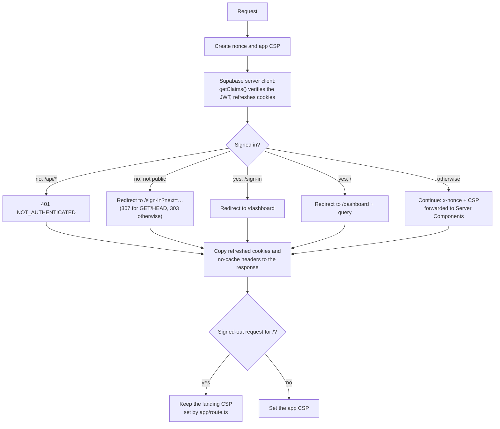

# Web app design

Type: living · Owner: tech lead · Last reviewed: 2026-11-11

Low-level design of `apps/web`: the Next.js dashboard and the public landing page, deployed on Vercel. Rules are in [AUTH](../../specs/v0/02-auth.md), [DASH](../../specs/v0/06-dashboard.md), [SEC](../../specs/v0/07-security-privacy.md) and [LAND](../../specs/landing/00-landing.md). The big picture is in the [overview](overview.md).

The browser never calls Supabase. Every Supabase call runs on the server with the user's cookie session or, in two routes, the secret key.

## Route map

| Route | Kind | Access | What it does | Specs |
|---|---|---|---|---|
| `/` | Route handler `app/route.ts` (static) | Public; signed-in visitors are redirected to `/dashboard` | Landing page HTML with its own CSP | LAND-01, 02, 06 |
| `/dashboard` | Server Component `app/(app)/dashboard` | Session | Cards, daily bar chart, platform donut for `?view=week|month&date=` | DASH-04..11, 15 |
| `/settings` | Server Component `app/(app)/settings` | Session | Tracked sites, extension status, account | DASH-12..14 |
| `/connect` | Server Component + client `connect-extension.tsx` | Session | Connects the extension (PING → link → CONNECT) | AUTH-06..09 |
| `/sign-in` | Page | Public; signed-in → `/dashboard` | Google and GitHub buttons | AUTH-01 |
| `/privacy` | Page | Public | Privacy notice from `PRIVACY_*` env | SEC-13 |
| `POST /auth/sign-in` | Route handler | Public, same origin | Starts OAuth PKCE; GitHub asks for `user:email` | AUTH-01, 05 |
| `GET /auth/callback` | Route handler | Public | Exchanges the code for cookies; `next` via `safeNextPath` | AUTH-01..03 |
| `POST /auth/sign-out` | Route handler | Same origin | `scope=local`, or `global` for all devices | AUTH-04, 12a |
| `POST /api/extension/link` | Route handler | Session, same origin | Single-use token hash; 5/min quota; secret key | AUTH-08, 09 |
| `POST /api/sites` | Route handler | Session, same origin | Adds a tracked site (normalized); duplicate = success | DASH-12, DATA-01 |
| `DELETE /api/sites/[id]` | Route handler | Session, same origin | Removes a tracked site | DASH-12 |
| `POST /api/account/delete` | Route handler (form) | Session, same origin, sign-in < 10 min | `admin.deleteUser`, clears cookies | DASH-14, AUTH-13, 14 |
| `/robots.txt`, `/sitemap.xml` | `app/robots.ts`, `app/sitemap.ts` | Public | Disallow `/api/`, `/auth/`; sitemap lists `/` and `/privacy` | LAND-07 |
| `/opengraph-image`, `/icon.svg`, `/fonts/*` | Generated image, static files | Public | Share image, favicon, self-hosted fonts | LAND-04, 07 |

Public paths are listed in `lib/auth/routes.ts` (`PUBLIC_PATHS`, `PUBLIC_EXACT_PATHS`). App pages carry `noindex` (`app/layout.tsx`).

## Request pipeline (`proxy.ts`)

The proxy runs on every request except `_next/static`, `_next/image` and `favicon.ico`. Prefetch requests are not excluded.

Redirect targets use `SITE_URL`, never the `Host` header (SEC-08).

## Security policies

`next.config.ts` adds the static headers to every response: `X-Frame-Options: DENY`, `X-Content-Type-Options: nosniff`, `Referrer-Policy: strict-origin-when-cross-origin`, a `Permissions-Policy` that denies camera, microphone, geolocation and payment, `Cross-Origin-Opener-Policy` and `Cross-Origin-Resource-Policy: same-origin`, and HSTS in production over https (SEC-09).

| Directive | App pages (`lib/security/headers.ts`) | Landing `/` (`lib/landing/csp.ts`) |
|---|---|---|
| `default-src` | `'self'` | `'none'` |
| `script-src` | `'self' 'nonce-…' 'strict-dynamic'` (+ `'unsafe-eval'` in dev); covers the analytics script, inserted by a nonce'd bundle | `'none'`; with analytics: `<site>/_vercel/insights/script.js` only |
| `style-src` | `'self' 'nonce-…'` (`'unsafe-inline'` in dev) | `'sha256-…'` of the one inline `<style>` |
| `style-src-attr` | `'unsafe-inline'` | `'unsafe-inline'` |
| `img-src` | `'self' blob: data:` | `'self' data:` |
| `font-src` | `'self'` | `'self'` |
| `connect-src` | `'self'` (includes `/_vercel/insights/*`) | (default `'none'`); with analytics: `<site>/_vercel/insights/` |
| `object-src` | `'none'` | (default `'none'`) |
| `base-uri` | `'self'` | `'none'` |
| `form-action` | `'self'`, the Supabase origin, Google, GitHub | `'none'` |
| `frame-ancestors` | `'none'` | `'none'` |
| `upgrade-insecure-requests` | when `SITE_URL` is https | when the site is https |
| Rendering | Per request (nonce) | Built once (`force-static`) |

Why two policies: [ADR-0009](../adr/0009-landing-route-and-rendering.md). "With analytics" means Vercel Web Analytics is enabled, which happens only on production deployments on Vercel (`isAnalyticsEnabled()` in `lib/analytics/config.ts`, SEC-15, [ADR-0010](../adr/0010-web-analytics.md)); the app CSP is the same either way. Mutating routes also check `Origin` against `SITE_URL` (`lib/security/origin.ts`, SEC-08); session cookies are `HttpOnly`, `SameSite=Lax`, `Secure` on https (`lib/supabase/cookies.ts`, AUTH-02).

## Data access

| Client | File | Key | Used by |
|---|---|---|---|
| Server client (per request) | `lib/supabase/server.ts` | Publishable key + user cookies | Server Components and route handlers; RLS applies |
| Proxy client | `proxy.ts` | Publishable key + request cookies | Session refresh only |
| Admin client | `lib/supabase/admin.ts` (`server-only`) | `SUPABASE_SECRET_KEY` | `/api/extension/link` (`generateLink`), `/api/account/delete` (`deleteUser`) |

| Call | From | Database object |
|---|---|---|
| `get_daily_totals` (period and today), `get_domain_totals` | `lib/dashboard/data.ts` | RPCs, `security invoker` |
| `tracked_domains` select | `/settings` | Table, RLS |
| `tracked_domains` insert / delete | `/api/sites`, `/api/sites/[id]` | Table, RLS, 50-site trigger |
| `consume_extension_link_quota` | `/api/extension/link` | RPC, `security definer` |
| `auth.getClaims()` | Proxy, pages | Verifies the JWT locally |
| `auth.getUser()` | Link route, account deletion | Confirms the session still exists on the server |

The viewer's time zone comes from the `tz` cookie set by `components/dashboard/time-zone-sync.tsx`; it is validated (`lib/dashboard/time-zone.ts`) and checked again by the database (DASH-07, DATA-10). Pure view logic lives in `lib/dashboard/*` and `lib/settings/*`.

Browser-side code talks to the extension through `lib/extension/messenger.ts` (2 s timeout, 15 s for `DISCONNECT`) and reads replies with `lib/extension/protocol.ts`, which also detects an outdated extension or another account (AUTH-07a/07b). Browser calls to the app's own API go through `lib/http/request.ts`, which validates every body with Zod.

## Error handling and logging

| Layer | Behavior |
|---|---|
| Route handlers | Reply `{ error: CODE }` with `Cache-Control: no-store` (`lib/http/json.ts`), e.g. `FORBIDDEN`, `NOT_AUTHENTICATED`, `INVALID_DOMAIN`, `LIMIT_REACHED`, `RATE_LIMITED`, `INTERNAL`. Form routes redirect back with `?error=` |
| Server logs | `logServerError(event, fields)` (`lib/log.ts`): one JSON line in Vercel runtime logs with code, status and a capped message; never emails, tokens, cookies, URLs or user input (ENV-11, SEC-06) |
| Pages | `app/error.tsx` and `app/global-error.tsx` show a friendly fallback; `app/not-found.tsx` for unknown routes |
| Configuration | `lib/env.ts` fails fast on a missing variable; `next.config.ts` fails a production build without the `PRIVACY_*` variables (SEC-13) |

## Landing page rendering

`app/route.ts` is a `force-static` GET handler. It calls `renderLanding()` (`lib/landing/page.ts`), which returns one HTML document with inline CSS and no JavaScript of its own (when analytics is enabled at build time, one `<script defer src="/_vercel/insights/script.js">`); interactions are native checkboxes and radios (LAND-08). The copy is in `lib/landing/content.ts` (LAND-03), links in `lib/landing/links.ts` (`EXTENSION_INSTALL_URL`, LAND-05), and the CSP hash is computed from the same CSS string (`lib/landing/csp.ts`). The origin comes from `buildSiteUrl()` (`SITE_URL`, then `VERCEL_PROJECT_PRODUCTION_URL`, then localhost), which is never used for security decisions.

## Web analytics

Vercel Web Analytics (SEC-15, [ADR-0010](../adr/0010-web-analytics.md)), only when `isAnalyticsEnabled()` (`VERCEL=1` and `VERCEL_ENV=production`):

| Pages | How | Privacy filter |
|---|---|---|
| App pages (root layout: sign-in, privacy, dashboard, settings) | `components/app/web-analytics.tsx` renders `<Analytics />` from `@vercel/analytics/next`, which inserts `/_vercel/insights/script.js` | `beforeSend` = `filterAnalyticsEvent` (`lib/analytics/before-send.ts`): drops `/auth/*` and `/connect`, keeps only `view` and `utm_*` query parameters, drops fragments |
| Landing `/` | `renderLanding({ analytics: true })` adds the script tag; `buildLandingCsp(…, site)` allows it | None (no script of our own); only `/` |

`/_vercel` is a public path (`lib/auth/routes.ts`), so page views of signed-out visitors are never redirected to sign-in should the proxy see them. The extension has no analytics.

## Configuration

Environment variables and their rules: ENV-05b in [specs/v0/09-environments.md](../../specs/v0/09-environments.md); template `apps/web/.env.example`.
