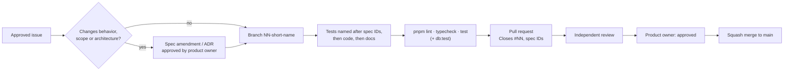

# Contributing

Type: living · Owner: tech lead · Last reviewed: 2026-11-12

How work moves from an idea to `main`. The rules for agents are in [AGENTS.md](../../AGENTS.md); this page is the full process behind them.

## Roles

| Role | Decides |
|---|---|
| Product owner | Scope, behavior, priorities, gate approvals, merge approval ("approved") |
| Tech lead | Specs and ADRs drafts, issue breakdown, assignment of parallel work, integration and merge |
| Reviewer | An agent or person who did not write the change |

## Gates

| Gate | Approves | Status |
|---|---|---|
| 1 | Understanding and direction | Done |
| 2 | v0 specs, architecture and backlog ([specs/v0](../../specs/v0/), [backlog](../history/backlog/v0.md)) | Done 2026-11-04 |
| 3 | v0 implementation, issue by issue | Done |
| 4 | v0 delivery ([report](../history/delivery/v0-delivery-report.md)) | Done |
| 5 | Each further iteration: its spec and issues | Per iteration (LAND, STORE so far) |

Nothing in [docs/roadmap.md](../roadmap.md) is authorized until it passes gate 5.

## Workflow per issue

1. Work only on an approved issue of the current iteration.
2. Read the spec IDs and ADRs the issue names. If the work needs a change of approved behavior, scope, architecture, security, cost or a dependency choice: stop, write the spec change or [ADR](../adr/README.md) as a proposal and ask the product owner.
3. Branch from `main`: `NN-short-name` (issue number first), e.g. `113-extension-local-data`.
4. Write or update tests named after requirement IDs (e.g. `TRK-05 …`), then implement the minimum that meets the acceptance criteria.
5. Run the checks locally (below) and open a pull request.
6. A reviewer who did not write the code checks spec adherence, security, correctness, tests and scope creep.
7. The product owner says "approved". Then the tech lead squash-merges.

## Definition of done

- [ ] Acceptance criteria of the issue met, nothing out of scope added.
- [ ] Tests named after spec IDs; `pnpm lint`, `pnpm typecheck` and `pnpm test` pass. `pnpm test` also runs the drift checks: spec constants (`constants.test.ts`), the database domain regex (`db-parity.test.ts`) and the README diagram ([`docs-parity.test.ts`](../../packages/shared/src/docs-parity.test.ts) against [overview](../architecture/overview.md)).
- [ ] UI changes to the landing page or the dashboard pass the responsive layout checks ([TEST-01](../../specs/v0/08-testing.md#21-responsive-layout): no horizontal scroll, nothing outside the viewport, centred groups centred, 44 px touch targets up to 768 px), and the PR links the CI screenshots artifacts (`responsive-screenshots-landing`, `responsive-screenshots-app`) of its latest run.
- [ ] `pnpm db:test` passes when `supabase/` changed. CI green, including integration, E2E and the backup round trip.
- [ ] Specs, ADRs and docs updated in the same PR. A changed spec gets a line `Amended <YYYY-MM-DD> (#issue): <what>` under its status line; existing ADRs are updated, not rewritten.
- [ ] No secrets, tokens or personal data in code, logs, docs or test fixtures.
- [ ] New dependency or pattern: one-line reason in the PR.
- [ ] Independent review done; product owner approved.

## Commits and pull requests

As practised in `git log`:

| Item | Convention | Example |
|---|---|---|
| Commit subject | Conventional Commits `type(scope): summary (#issue)`; the squash merge appends `(#PR)` | `feat(store): Chrome Web Store package, listing and images (#128) (#129)` |
| Types | `feat`, `fix`, `docs`, `test`, `chore` (once `spike`) | |
| Scopes (optional) | The area: `extension`, `engine`, `web`, `ui`, `db`, `auth`, `shared`, `landing`, `store`, `ci`, `delivery`, `deps-dev` | |
| Commit body | One short paragraph of what changed, then `Closes #NN` | |
| Trailers | Co-author and session lines when an agent wrote the change | |
| PR title | Commit-subject style, or `Area: summary (#issue)` | `Extension: forget local data, account-scoped state, minimal session (#113)` |
| PR body | What and why, spec IDs, `Closes #NN`, test evidence | |
| Merge | Squash merge; Dependabot PRs use a merge commit | |

## Checks

| Command | Runs |
|---|---|
| `pnpm lint` | Biome lint and format check |
| `pnpm typecheck` | TypeScript in every workspace |
| `pnpm test` | Unit and component tests plus drift checks (Vitest) |
| `pnpm db:test` | pgTAP tests (local Supabase in Docker) |
| `pnpm test:responsive` | Landing responsive layout in Chromium (TEST-01); screenshots in `responsive-screenshots/` |
| `scripts/ci/integration.sh` | Integration and E2E in Chromium, including the app pages' responsive layout (TEST-01) |

CI (`.github/workflows/ci.yml`) runs all of them on every pull request and push to `main` (ENV-08). Vercel builds a preview of the dashboard for each pull request.

## Documentation

Where things go and how docs are kept current: [docs/README.md](../README.md).
